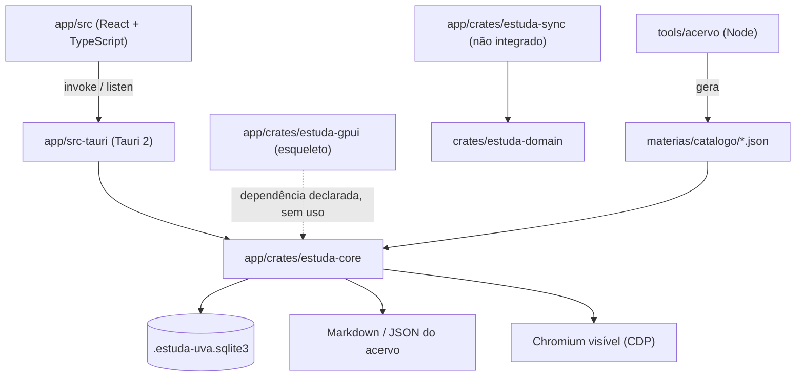
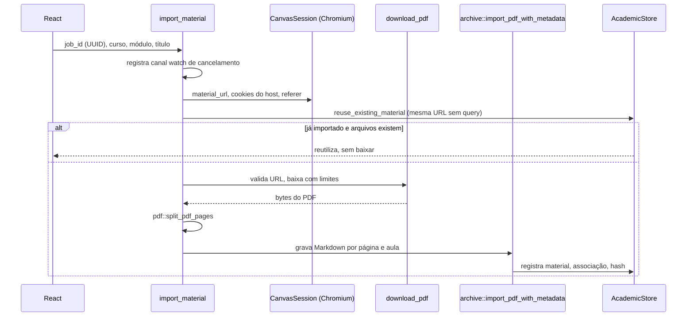
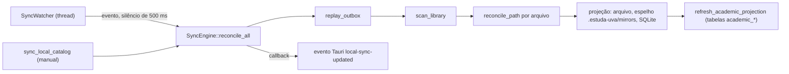

# Visão geral da arquitetura

**Revisado em:** 2026-11-06 · **Base:** commit `3811300` mais a árvore de trabalho **não commitada** (a extração de `estuda-core` ainda não está no Git).

Este documento descreve o código que existe hoje. Os arquivos `README.md` e `01`–`05` desta pasta são outro conjunto: **propostas e decisões de arquitetura-alvo** (por exemplo `estuda-storage`, `estuda-portal`, `estuda-cli`, bancos privado e público separados), escritas em paralelo; o que elas descrevem como "proposto" não existe no código, e a decisão de 6/11/2026 em [05-decisao-estrutura-atual.md](05-decisao-estrutura-atual.md) mantém a estrutura de diretórios atual. Onde algo é planejado, está marcado como **Planejado**. Legenda usada em toda a documentação técnica: **Implementado**, **Parcial**, **Planejado**, **Não verificado**.

## Resumo

| Camada | Onde | Estado |
|---|---|---|
| Acervo em texto (Markdown/JSON) | `materias/`, `fontes-uva/`, `periodos/`, `dados/`, `privado/` | Implementado |
| Gerador do acervo (Node) | `tools/acervo/` | Implementado |
| Tipos de domínio (sem I/O) | `crates/estuda-domain/` | Implementado, **ainda não usado por `estuda-core`** (ver [decisões pendentes](decisoes-pendentes.md)) |
| Núcleo Rust (SQLite, sincronização, scanner, Canvas/Portal) | `app/crates/estuda-core/` | Implementado (152 testes passam; não commitado) |
| Motor de leitura acadêmica somente-leitura | `app/crates/estuda-sync/` | **Código presente, não verificado, não integrado** (ver [crates](crates.md#estuda-sync)) |
| Shell Tauri (comandos, estado, eventos) | `app/src-tauri/` | Implementado, é o **único aplicativo executável** hoje |
| Interface React | `app/src/` | Implementado |
| Interface GPUI | `app/crates/estuda-gpui/` | **Parcial / esqueleto**: na última leitura (2026-11-06 00:55) abre uma janela com o texto "Estuda UVA" via `gpui-kit` 0.9.0; não usa `estuda-core` nem tem telas. O arquivo mudou durante esta revisão (antes era `fn main() {}`); **não compilado por esta revisão** |

## Camadas e dependências



Leitura do diagrama: a interface React chama comandos Tauri; o shell delega tudo a `estuda-core`. Linha tracejada: `estuda-gpui` declara a dependência em `Cargo.toml`, mas o `main.rs` não usa nada de `estuda-core`. `estuda-sync` depende de `estuda-domain`, mas `estuda-core` não depende de nenhum dos dois. O gerador Node produz os JSON legados (`materias/catalogo/*.json`) que `estuda-core` lê.

Referências: `app/Cargo.toml` (workspace com `estuda-core`, `estuda-gpui`, `estuda-sync`; `src-tauri` excluído), `app/src-tauri/Cargo.toml` (`estuda-core = { path = "../crates/estuda-core" }`), `crates/estuda-domain/Cargo.toml` (workspace próprio).

## Organização do repositório relevante para o código

```text
app/
├── Cargo.toml              # workspace Rust (resolver 3, edition 2024, rust-version 1.90)
├── crates/estuda-core/     # núcleo (sem UI)
├── crates/estuda-gpui/     # esqueleto GPUI (janela vazia)
├── crates/estuda-sync/     # em criação
├── src-tauri/              # shell Tauri legado (fora do workspace)
├── src/                    # frontend React
└── scripts/                # testes Node do frontend
crates/estuda-domain/       # tipos de domínio (workspace próprio)
tools/acervo/               # gerador/validador Node
```

## Caminhos de execução

Todos os passos abaixo foram conferidos no código. Os comandos Tauri estão em `app/src-tauri/src/lib.rs`.

### 1. Inicialização (`run()`, `app/src-tauri/src/lib.rs`)

1. Registra o plugin `tauri_plugin_dialog` e executa `setup`.
2. Determina o diretório de dados do app (`app_data_dir`) e o acervo padrão: `CARGO_MANIFEST_DIR/../..`, ou seja, a raiz do repositório **fixada em tempo de compilação**.
3. `AcademicStore::open_workspace` abre o banco. Se o banco legado (`<app_data_dir>/estuda-uva.sqlite3`) guarda a chave `library_path` apontando para uma pasta existente, o acervo é essa pasta; senão, o padrão. O banco efetivo é `<acervo>/.estuda-uva.sqlite3`. Dados do banco legado são importados uma vez (`ATTACH` e `INSERT OR IGNORE`, marcado por `__legacy_database_imported`).
4. `catalog::guidance::create_missing_guidance` cria `AGENTS.md` e `CLAUDE.md` na raiz do acervo **somente se não existirem** (`create_new`). É uma escrita feita na inicialização.
5. Cria `CatalogService` (índice vazio), `SyncEngine::open` (segunda conexão ao mesmo arquivo SQLite) e `SyncWatcher::start` (thread de monitoramento).
6. Registra `AppState` (`store`, `sync`, `catalog`, `watcher`, `canvas_operation`, `session`, `active_imports`, `active_captures`) e os 52 comandos de `invoke_handler`.

### 2. Carregamento do perfil e da biblioteca

Não há "perfil" de usuário nem login do app: o estado pessoal é o próprio banco local. O frontend, ao montar, executa `refreshLocalLibrary` (`app/src/ui/App.tsx`):

1. `sync_local_catalog` → `SyncEngine::reconcile_all`.
2. Em paralelo: `refresh_local_catalog` (`CatalogService::refresh`), `local_sync_conflicts`, `academic_catalog`, `repository_status`.

`CatalogService::snapshot()` falha com "O acervo ainda não foi indexado" até o primeiro `refresh`.

### 3. Pesquisa local

`search_local_library` → `CatalogService::search` (em `spawn_blocking`). Pesquisa o texto já indexado em memória (`text_by_path`), no máximo 100 resultados. Limites em [performance](../desenvolvimento/performance.md).

### 4. Importação de material do Canvas



Explicação: a importação individual valida o URL (`download::validate_material_url`), tenta reutilizar material local, baixa o PDF apenas em memória, extrai texto por página, recusa PDF sem texto e grava somente Markdown (o teste `imported_material_is_markdown_idempotent_and_never_keeps_raw_pdf` em `estuda-core/src/lib.rs` verifica que nenhum `.pdf` sobra no disco). O cancelamento é um `tokio::sync::watch` por `job_id`. A captura em lote usa o mesmo caminho em `run_canvas_capture` (ver [Canvas](../automacoes/canvas.md)).

### 5. Sincronização e reconciliação



Passos (`app/crates/estuda-core/src/sync.rs`): (1) reaplica operações pendentes da tabela `sync_outbox`; (2) `scan_library` lista os documentos no escopo; (3) para cada `md`, `markdown`, `json`, `txt`, `alg`, `csv` fora das exclusões sensíveis, `reconcile_path` compara três superfícies (SQLite, Markdown, JSON espelho) com o conteúdo-base; mudanças iguais propagam, mudanças divergentes viram registro em `sync_conflicts` sem sobrescrever; (4) arquivos que sumiram geram `sync_tombstones` e um conflito de restauração; (5) as tabelas `academic_*` são reconstruídas dos JSON do catálogo. Detalhes do modelo de dados em [sincronização de dados](../dados/sincronizacao.md).

### 6. Atualização da interface

O monitor chama o callback passado em `SyncWatcher::start`, que faz `app_handle.emit("local-sync-updated", report)`. O frontend escuta o evento (`listen<SyncReport>("local-sync-updated")` em `App.tsx`), guarda o relatório e chama `refreshLocalLibrary`. A captura do Canvas emite `canvas-capture-updated`. Além disso, `refresh()` roda a cada 3 s por `setInterval`. Mais em [eventos e estado](eventos-e-estado.md).

### 7. Encerramento

- **`SyncWatcher`**: `Drop` marca `stop` (`AtomicBool`) e faz `join` na thread (a espera por eventos tem tempo máximo de 200 ms).
- **`CanvasSession`**: `disconnect_canvas` chama `session.close()`, que fecha as páginas, pede o fechamento do Chromium (5 s), espera a saída (5 s) e, se falhar, usa `kill` (5 s), e aborta a tarefa do manipulador CDP.
- **Saída do aplicativo**: não há `on_window_event` nem `RunEvent` no `lib.rs` que feche a sessão do Chromium. O que acontece com o processo do Chromium quando o app fecha sem `disconnect_canvas` **não foi verificado**.
- SQLite usa `journal_mode=WAL`; não há rotina explícita de checkpoint no encerramento.

## Limites conhecidos desta arquitetura

- Dois componentes diferentes abrem o **mesmo arquivo SQLite** (`AcademicStore` e `SyncEngine`), cada um com sua conexão e seu `Mutex`. O isolamento depende do modo WAL.
- O escopo do scanner e do sincronizador não acompanha a reorganização que moveu dados pessoais para `privado/` (ver [decisões pendentes](decisoes-pendentes.md)).
- A UI React ainda afirma "Sem IA, nuvem ou cobrança por uso" na barra lateral (`App.tsx`), enquanto o código inclui um cliente da API Anthropic (`anthropic.rs`, `study_summaries.rs`).
