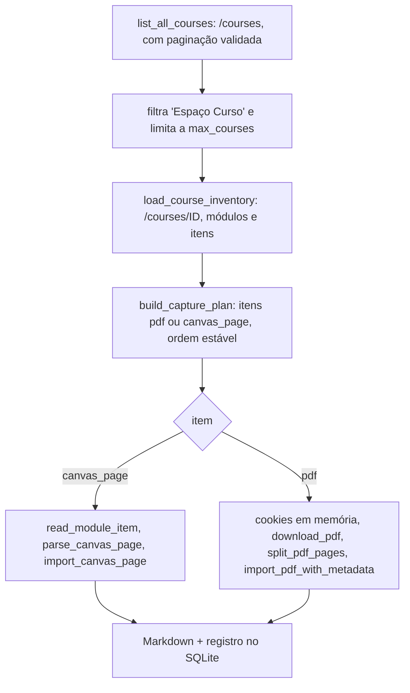

# Canvas UVA

**Revisado em:** 2026-11-06 · **Estado:** **Implementado** em código e testes offline (`canvas.rs` 8, `canvas_api.rs` 8, `canvas_capture.rs` 6, `download.rs` 6, `archive.rs` 6). **Não verificado:** nenhuma varredura nem leitura de API autenticada foi executada pelo app (ver [`../ESTADO_IMPLEMENTACAO_ESTUDA_UVA.md`](../ESTADO_IMPLEMENTACAO_ESTUDA_UVA.md)). Compilar e passar nos testes não comprova que os cursos foram baixados.

Procedimentos por tela (C1 a C8) estão em [`../NAVEGACAO_PORTAL_UVA.md`](../NAVEGACAO_PORTAL_UVA.md). Aqui está a automação em Rust, dividida em três usos do mesmo sistema.

## Ficha comum

| Campo | Valor |
|---|---|
| Sistema de origem | `https://uva.instructure.com` (constante `CANVAS_ORIGIN` em `canvas_api.rs`) |
| Método de acesso | Janela Chromium visível (`chromiumoxide`/CDP, `CanvasSession::launch`, perfil próprio). Leitura de HTML com `page.content()` e `scraper`; leitura de JSON com `fetch` executado **dentro da página autenticada** (`browser.rs`, `canvas_api_json`) |
| Dependências | Chromium/Chrome; `scraper`; `reqwest` (rustls) só para baixar PDF; `pdf-extract` para o texto |
| Autenticação | Manual na janela do app. `CanvasSession::status` detecta login (`/login`, `/sso`, `login_form`, campo de senha) e sessão expirada |
| Estados | `disconnected`, `waiting_for_login`, `authenticated`, `session_expired`, `browser_error` (`CanvasState`) |
| Inicialização | Chromium 20 s para abrir; abre `https://uva.instructure.com/courses` |

## Uso 1: inventário e captura de materiais

**Informação consultada:** lista de disciplinas (`/courses`, atuais e anteriores), módulos de cada disciplina, páginas de aula e links de PDF.

Texto equivalente: o plano é montado antes de baixar qualquer coisa; depois cada item é processado em sequência (não em paralelo) e seu estado é gravado no SQLite.

### O que é ignorado por construção

`parse_module_items` e `module_item_url` recusam caminhos que contenham `/assignments/`, `/discussion_topics/`, `/quizzes/`, `/submissions/`, `/gradebook` e `/grades`. A captura em lote não toca em avaliações, fóruns, notas, frequência nem entregas. "Espaço Curso" é excluído por `is_support_course`. Vídeo, e-book de biblioteca licenciada e conteúdo com DRM estão fora do escopo (nenhum código os trata).

### Limites

| Limite | Padrão | Faixa aceita | Onde |
|---|---|---|---|
| Páginas da lista de disciplinas | 100 | 1 a 100 | `CanvasCaptureLimits.max_course_pages` |
| Disciplinas | 200 | 1 a 500 | `max_courses` |
| Itens no total | 10.000 | 1 a 20.000 | `max_items` (também `clamp(1, 20_000)` em `load_course_inventory`) |
| Tamanho do PDF | 60 MiB | 1 a 60 MiB | `max_pdf_bytes`, constante `MAX_PDF_BYTES` |
| Redirecionamentos | 4 | 0 a 4 | `max_redirects`, `MAX_REDIRECTS` |
| Tempo limite do download de cada PDF | 45 s | 5 a 120 s | `item_timeout_seconds` (repassado a `DownloadLimits.timeout_seconds`; não há limite equivalente documentado para itens de página) |

Os limites são validados em `CanvasCaptureLimits::validate`, ficam salvos no banco (`get_capture_limits` / `set_capture_limits`) e são copiados para `capture_runs.limits_snapshot` no início de cada execução. `download_pdf` repete a checagem e recusa valores fora da faixa (`InvalidLimits`).

### Download de PDF

`download::download_pdf` (`reqwest`, TLS por rustls, `redirect::Policy::none()`: os redirecionamentos são tratados manualmente):

- `validate_material_url` aceita só HTTPS, sem userinfo, porta ausente ou 443, e host `uva.instructure.com`, `uva.br`, `*.uva.br` ou um **S3 assinado** (`*.s3[.região].amazonaws.com` com parâmetros de assinatura v2 ou v4). Rejeita `evil-eaduva.br`, `ead.uva.br.attacker.example`, `http:` e `file:` (teste `material_urls_require_https_and_uva_host_boundaries`).
- Cada redirecionamento é revalidado. Ao mudar de host, o cookie e os validadores (`ETag`, `Last-Modified`) deixam de ser enviados.
- O cookie vai só ao host inicial: `CanvasSession::cookies_for_host` lê os cookies do Chromium via CDP, filtra por domínio e validade e monta o cabeçalho **em memória**. Nada é gravado.
- O corpo é lido em blocos e abortado ao passar de `max_bytes`; deve começar com `%PDF-` e ter `Content-Type` `application/pdf` (ou `octet-stream` com caminho `.pdf`), senão `NotPdf`.
- Requisição condicional: se há `ETag`/`Last-Modified` do host, envia `If-None-Match`/`If-Modified-Since`; `304` vira `NotModified` e o PDF não é baixado de novo.

### Idempotência e cache

| Mecanismo | Como funciona | Código |
|---|---|---|
| `reference_key` | Hash SHA-256 de `curso, módulo, URL do item sem query`. Identifica o item do plano de captura | `canvas::reference_key` |
| `content_key` / `source_key` | `pdf:<sha256>` ou `canvas_page:<sha256>` do identificador `files/<id>` do Canvas, ou da URL sem query | `canvas::content_key`, `archive::pdf_source_key` |
| `text_sha256` | Hash do texto extraído. Mesma `source_key` e mesmo `text_sha256` = **reaproveitamento** (`Reused`), sem escrever arquivo novo | `archive::persist_material_version` |
| `sha256` | Hash do Markdown gravado. Se difere do arquivo em disco, houve **edição local** | `persist_material_version` |
| Reuso por URL | `reuse_existing_material` e `store.find_material_by_origin` evitam baixar de novo quando Markdown e aula locais ainda existem e o hash confere | `archive.rs` |
| Validadores HTTP | `source_etag`, `source_last_modified`, `source_validator_host` gravados em `materials` | `storage.rs` |

Resultados possíveis de um item (`CaptureItemStatus`): `pending`, `running`, `captured`, `reused`, `ignored`, `failed` (com `retryable`), `needs_review`. Quando a origem mudou ou há edição local, a nova versão é gravada com sufixo do hash (`-<12 primeiros caracteres>`) e o item vira `needs_review`; **nenhum arquivo existente é sobrescrito** (`write_new_or_equal` usa gravação atômica sem sobrescrever).

### Retomada, falhas e cancelamento

- **Estados da execução** (`CaptureRunStatus`): `running`, `waiting_for_login`, `cancelled`, `partial`, `completed`, `failed`. `terminal_run_status` decide pelo conjunto de sinais.
- **Retomar:** `resume_canvas_capture` reexecuta os itens `pending` e os `failed` com `retryable`. Uma execução `running` sem tarefa ativa (app fechado) é rebaixada a `partial` por `recover_interrupted_capture_run`.
- **Repetir um item:** `retry_canvas_capture_item`.
- **Sessão expirada:** a execução vira `waiting_for_login`; o estudante entra de novo e retoma.
- **Cancelar:** `cancel_canvas_capture` envia `true` ao `watch::Sender` guardado em `active_captures`. O laço checa o sinal entre itens e dentro do download; os itens já confirmados são mantidos. Para importação individual existe `cancel_import` com `active_imports`.
- **Falha de um item** não derruba a execução: vira `failed` com mensagem e a execução termina `partial`.

### Proveniência gravada

- Tabela `materials`: `origin` (URL sem query/fragmento/userinfo), `source_key`, `source_kind` (`pdf` ou `canvas_page`), `source_etag`, `source_last_modified`, `source_validator_host`, `sha256`, `text_sha256`, `imported_at`, `semester`, `pages`.
- Tabela `material_associations`: `material_id`, `course_id`, `course_title`, `module_title`, `item_title`, `semester`.
- Tabelas `capture_runs` e `capture_items`: estado, contadores e mensagem por item.
- Cabeçalho do próprio Markdown: bloco `<!-- estuda-uva-capture -->` com disciplina, módulo, material, fonte, data e hora da captura e tipo ("PDF convertido localmente", "Página textual do Canvas", "Aula derivada do PDF").
- O período (`semester`) só é gravado quando `confirmed_current_semester` encontra correspondência com uma matrícula ativa no catálogo local; senão fica desconhecido. Não há inferência.

O esquema completo dessas tabelas está em [`../dados/banco-privado.md`](../dados/banco-privado.md).

## Uso 2: notas, fóruns, avisos e Caixa de Entrada (API)

**Informação consultada:** notas e feedback das atividades online (A1), tópicos de fórum e respostas, avisos e conversas da Caixa de Entrada. A nota oficial continua sendo a do boletim do Lyceum; esta captura **não** altera `dados/notas/`.

**Método:** `capture_canvas_academic` executa `fetch` com `credentials: "same-origin"` dentro da página do Canvas já autenticada, lê o JSON e segue o cabeçalho `Link rel="next"` até `max_pages`. Comando Tauri: `refresh_canvas_academic`, com opções `grades`, `forums`, `announcements`, `inbox` (a Caixa de Entrada vem desmarcada na interface por conter mensagens privadas). Exige ao menos uma opção.

| Caminho (todos `GET`) | Para quê |
|---|---|
| `/api/v1/courses/:id/assignments?include[]=submission&per_page=100` | notas e situação |
| `/api/v1/courses/:id/assignments/:aid/submissions/self?include[]=submission_comments` | feedback |
| `/api/v1/courses/:id/discussion_topics?per_page=100` e `.../:tid/view` | fóruns |
| `/api/v1/courses/:id/discussion_topics?only_announcements=true&per_page=50` | avisos |
| `/api/v1/conversations?scope=inbox&per_page=50` e `/api/v1/conversations/:cid?auto_mark_as_read=false` | Caixa de Entrada |

### Somente leitura, por construção

1. `canvas_api::validate_api_path` é chamada antes de **toda** consulta. Aceita só caminhos relativos `/api/v1/` com caracteres `[A-Za-z0-9/_-]` na rota e `[A-Za-z0-9=&_\[\]-]` na query; recusa `//` e `..`.
2. Para `/api/v1/conversations/<id>`, exige `auto_mark_as_read=false`; sem isso devolve erro. Sem o parâmetro, abrir a conversa a marcaria como lida. Teste: `validate_api_path("/api/v1/conversations/99?auto_mark_as_read=true")` é recusado.
3. O script JavaScript confere `url.origin === location.origin` e prefixo `/api/v1/` a cada página.
4. Só `fetch` com método padrão (GET). Não há `POST`, `PUT` ou `DELETE` no módulo.
5. IDs numéricos de até 20 dígitos (`numeric_id`).

**Não verificado:** que a leitura de `submission_comments` não altera o indicador de comentário não lido na instância real. O guia `NAVEGACAO_PORTAL_UVA.md` (C4) já marca como "a validar".

### Limites

| Limite | Valor | Constante |
|---|---|---|
| Disciplinas | 40 | `MAX_COURSES` |
| Páginas por listagem | 10 | `MAX_LIST_PAGES` |
| Consultas de feedback por disciplina | 40 | `MAX_COMMENT_LOOKUPS_PER_COURSE` |
| Tópicos por disciplina | 60 | `MAX_TOPICS_PER_COURSE` |
| Respostas por tópico | 2.000 | `MAX_ENTRIES_PER_TOPIC` |
| Conversas lidas por inteiro | 100 | `MAX_CONVERSATIONS` |
| Tamanho de texto por entrada | 20.000 caracteres (corta com ` […]`) | `MAX_TEXT_CHARS` |
| Tempo por consulta | 45 s | `canvas_api_json` |
| Saída | 64 MB (JSON e Markdown) | `persist_capture` |

### Falhas e proveniência

Cada falha vira aviso (HTTP 401 = "sessão do Canvas expirada", 403, 404, outros) e marca a captura como parcial sem interromper o resto. Campos de controle: `capturedAt`, `complete`, `warnings`, `options`; por item de nota `commentsChecked`; por fórum `entriesComplete`; por conversa `messagesChecked`; `sourceUrl` só com host `uva.instructure.com`, sem query e fragmento. Saída: `materias/catalogo/capturas/canvas-<uuid>.json` e `.md` e sincronizada com o SQLite. Hoje o **código** grava nessa pasta, que o `.gitignore` ignora; alinhar caminho e ignore à política de publicação do dono (`AGENTS.md`, 6/11/2026: notas, frequência, matrículas e trabalhos podem ser versionados, separados do catálogo, em `privado/`) é **decisão pendente**. A captura contém também mensagens de terceiros (docentes e colegas), que merecem revisão antes de qualquer publicação. Continuam vedados ao Git: cookies, URLs assinadas, tokens e os bancos SQLite. Ver [`../seguranca/privacidade.md`](../seguranca/privacidade.md).

Esta leitura **inclui** o Espaço Curso, ao contrário da captura de materiais.

## Uso 3: prazos

Ver [calendario.md](calendario.md).

## Informações não disponíveis

- Vídeos, e-books licenciados, conteúdo com DRM.
- Qualquer entrega, presença ou conclusão: o app não marca nada.
- Frequência oficial: vem do Portal/Lyceum.
- Materiais de cursos sem acesso, PDFs sem camada de texto (sem OCR) e links não suportados ficam identificados com motivo no resultado, nunca como baixados.
- O acesso do app **pode aparecer no histórico de acessos do Canvas** (ver `app/README.md`).

## Divergências

- `NAVEGACAO_PORTAL_UVA.md` (regra 2) diz que o app não "reaproveita cookies"; ele não os grava, mas os usa em memória para o download (acima).
- `app/README.md` descreve a captura a partir de `npm run tauri dev` e de caminhos `src-tauri`; os módulos Rust agora estão em `app/crates/estuda-core/src/`.
- `app/README.md` diz "PDFs acessíveis são validados e convertidos... o PDF bruto temporário é descartado". Confere: `archive.rs` não grava o PDF; o teste `imported_material_is_markdown_idempotent_and_never_keeps_raw_pdf` verifica que não há arquivo `.pdf` no acervo temporário.
