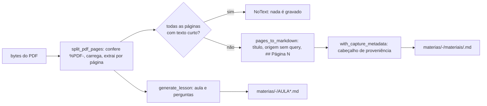

# Extração textual, normalização e aula local

**Revisado em:** 2026-11-06 · **Estado:** **Implementado**. Regra do acervo: o que é versionado é texto. PDF e documentos (Word, Pages) viram Markdown com página e fonte; binários ficam fora do Git (`AGENTS.md`).

**OCR não existe.** Nenhum módulo reconhece texto em imagem. PDF sem camada de texto é sinalizado, não lido.

Há dois conjuntos de ferramentas, com propósitos diferentes:

| Conjunto | Entrada | Uso | Código |
|---|---|---|---|
| Núcleo Rust | bytes de PDF/páginas do Canvas baixados pelo app; arquivos locais do acervo | importação de materiais, leitor e busca do acervo, aula guiada | `app/crates/estuda-core/src/pdf.rs`, `archive.rs`, `canvas.rs`, `catalog/documents.rs`, `lesson.rs`, `tutor.rs` |
| Gerador do acervo | PDF local escolhido pelo usuário | conversão manual de PDF oficial para `fontes-uva/` | `tools/acervo/src/pdf-para-md.mjs` |

## Formatos suportados pelo leitor do acervo

`extract_document` (`catalog/documents.rs`) decide pela extensão. Limite: **64 MB** por arquivo (`DocumentError::TooLarge`). Quebras `\r\n` são normalizadas para `\n`.

| Extensão | Formato | Como é lido | Avisos emitidos |
|---|---|---|---|
| `md`, `markdown`, `txt`, `alg`, `csv` | texto | UTF-8 literal; erro se não for UTF-8 | nenhum |
| `json` | JSON | texto literal, sem reordenar campos | se inválido, preservado como texto, com aviso |
| `html`, `htm` | HTML | `scraper` extrai o texto simples; **marcação não é exibida nem executada** | sempre avisa que virou texto simples |
| `pdf` | PDF | `pdf::split_pdf_pages` (crate `pdf-extract`), uma seção `## Página N` por página, com `page_boundaries` | sem texto: "não faz OCR" |
| `docx` | Word | leitura do `word/document.xml` com `quick-xml`, na ordem original de parágrafos e tabelas; se não for possível ordenar, cai em `docx-lite` | paginação e formatação não preservadas; aviso extra no *fallback* |
| `pages` | Pages | `iwork` extrai os armazenamentos de texto; cada um vira uma seção rotulada | paginação e formatação não preservadas |
| outras | n/d | `DocumentError::Unsupported` | n/d |

`archive.rs`, `catalog/scanner.rs` e `sync.rs` ficam em cima deste leitor; o escaneamento é limitado (10.000 arquivos, profundidade 16, 128 MB de texto indexado, 100 resultados de busca). Ver [`../dados/sincronizacao.md`](../dados/sincronizacao.md).

## PDF para Markdown no núcleo Rust

Texto equivalente: o PDF é lido da memória, convertido página a página, gravado como Markdown e descartado. Nenhum PDF fica no acervo.

Garantias verificáveis em `pdf.rs` e `archive.rs`:

- **Falha explícita, nunca parcial:** se o número de páginas extraídas difere do número de páginas do documento, `PdfError::Partial { extracted, expected }`. PDF protegido ou inválido vira `PdfError::Extract`.
- **Sem texto:** se todas as páginas têm menos de 6 caracteres, `ArchiveError::NoText` e **nenhum arquivo é criado** ("o original não foi guardado"); teste `image_only_or_invalid_pdf_does_not_create_archive_output`.
- **Página vazia** dentro de um PDF com texto aparece como `_Nenhum texto extraível nesta página._`.
- **Escape de Markdown:** `escape_markdown_text` protege `` \ ` * _ { } [ ] ( ) # + - . ! | `` e `& < >`; título e texto de páginas não injetam HTML ou links (teste `markdown_preserves_page_origins_and_removes_query_secrets`).
- **Origem sanitizada:** `pages_to_markdown` remove userinfo, query e fragmento; nunca grava token (teste `origin_markdown_never_persists_url_userinfo`).
- **Links perigosos:** `sanitize_lesson_markdown` remove `javascript:` e `data:` das linhas.
- **Nomes de arquivo:** `safe_slug` normaliza acentos e separadores (`"Introdução à Web / U1"` vira `introducao-a-web-u1`; vazio vira `material`).
- **Sem sobrescrita:** `write_new_or_equal` cria o arquivo ou reutiliza um idêntico; se existir um diferente, usa sufixo `-2`, `-3`... (até 10.000). Edições manuais em `materias/` e nos `README.md` fora do bloco `estuda-uva:start/end` são preservadas.

Limitação: o texto extraído **não contém diagramas, imagens ou o layout visual**; a paginação reflete as páginas do PDF e deve ser conferida no material oficial.

## Página de aula do Canvas para Markdown

`canvas::parse_canvas_page` escolhe a raiz de conteúdo (`.user_content`, `#wiki_page_show`, `#content`, `main` ou `body`, a primeira com texto) e percorre o HTML com `render_markdown_node`. Só aceita URL HTTPS de `uva.instructure.com` sem userinfo. Título vem de `h1` ou `[data-testid='page-title']`. Se não há texto nem PDF, devolve `unsupported_reason` ("A página não contém texto selecionável nem PDF acessível") e o item é ignorado. Gravado com `import_canvas_page`, `source_kind = canvas_page`.

## Aula guiada e tutor (sem IA)

Ambos são **determinísticos e locais**: o mesmo texto produz o mesmo resultado.

| Módulo | Faz | Regras |
|---|---|---|
| `lesson.rs` `generate_lesson` | Monta "Aula guiada" com mapa de páginas, trecho de leitura (primeira linha com mais de 35 caracteres) e perguntas | Pergunta nasce de uma linha de definição (`definition_in`: marcadores ` significa `, ` é definido como `, ` é definida como `, `: `). O texto declara "Não é uma explicação gerada por IA". Cada pergunta guarda `source_page` |
| `lesson.rs` `score_answer` | Nota 0 ou 1 | Compara respostas **normalizadas** (sem acento, caixa e pontuação); só vale igualdade exata |
| `tutor.rs` `build_tutor_activity` | Atividade por seção: *verificável* (há definição) ou *autoavaliação* (não há) | Linhas de metadados da captura (`Disciplina:`, `Fonte oficial:`, `PDF original:`...) são ignoradas para não virarem pergunta |
| `tutor.rs` `assess_tutor_answer` | Resposta vazia = `pending`; igual à referência = `correct`; senão `self_assessed` | **Nunca declara "errado"**: uma paráfrase vai para revisão da fonte |
| `tutor.rs` `hash_section_markdown` | SHA-256 da seção | Fica em `lesson_interactions.source_sha256` para provar de qual trecho veio a resposta |

Efeito acadêmico: **nenhum**. Sessões e respostas ficam no SQLite local (`lesson_sessions`, `lesson_interactions`, `study_sessions`) e não alteram frequência, notas, matrícula ou entregas oficiais.

Limitação: sem definição explícita no texto, o app não inventa pergunta; mostra um roteiro de leitura e pede autoavaliação.

## Conversão manual com `pdftotext`

`node tools/acervo/src/pdf-para-md.mjs <arquivo.pdf> <saida.md> "<fonte>"` (`tools/acervo/src/pdf-para-md.mjs`):

- Requer `pdfinfo` e `pdftotext` (poppler) no `PATH`; chama `pdftotext -layout -enc UTF-8`.
- Cada página vira `## Página N`; página sem texto vira `_Página sem texto selecionável._` e o comando devolve a lista `semTexto`.
- Cabeçalho do Markdown cita o nome do PDF, o total de páginas, a fonte e o aviso de que imagens e diagramas não são reproduzidos.
- **Não remove nem move o PDF.** O PDF original permanece local e fora do Git.
- Escreve apenas em `<saida.md>`. Quem escolhe a saída (normalmente `fontes-uva/<período>/<matéria>/`) é o usuário.

Diferença para o núcleo Rust: usa `pdftotext -layout` (preserva colunas) em vez de `pdf-extract`, e não aplica o escape de Markdown de `pdf.rs`.

## Diagramas e imagens

Regra do acervo: viram Mermaid ou descrição textual; a imagem pode ficar local mas não é versionada. Nenhum código converte imagem em Mermaid; é trabalho manual de revisão.

## Testes associados

| Área | Testes |
|---|---|
| `catalog/documents.rs` | 6: Markdown, JSON, HTML, DOCX em ordem, tabela entre parágrafos, Pages |
| `pdf.rs` | 1 (origem sem userinfo); `lib.rs` cobre divisão de PDF, Markdown, `safe_slug`, aula determinística, importação idempotente e PDF sem texto |
| `lesson.rs` | 1 (links Markdown viram texto simples) |
| `tutor.rs` | 11 |

**Atenção:** os testes de DOCX e Pages em `catalog/documents.rs` leem arquivos reais em `originais/paradigmas-de-programacao/` (binários originais; pasta vedada ao Git pela política do dono) e localizam a raiz subindo até achar `originais/`. Em um clone sem esses arquivos, esses testes falham. Ver [`../desenvolvimento/testes.md`](../desenvolvimento/testes.md).
