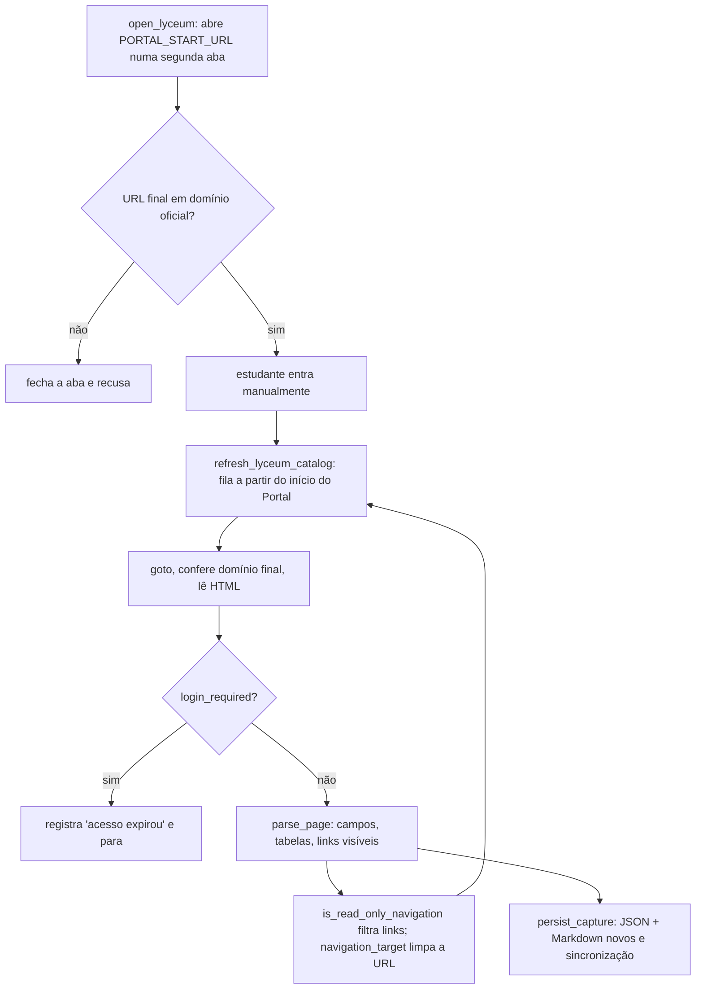

# Portal do Aluno e Lyceum

**Revisado em:** 2026-11-06 · **Estado:** **Implementado** em código e testes offline (8 testes em `lyceum.rs`). **Não verificado:** uma captura automatizada completa e autenticada do histórico não foi executada (ver [`../ESTADO_IMPLEMENTACAO_ESTUDA_UVA.md`](../ESTADO_IMPLEMENTACAO_ESTUDA_UVA.md)).

O passo a passo de cada tela do Portal e dos seus subsistemas está em [`../NAVEGACAO_PORTAL_UVA.md`](../NAVEGACAO_PORTAL_UVA.md) e não é repetido aqui. Este documento descreve a automação em Rust.

## Ficha

| Campo | Valor |
|---|---|
| Sistema de origem | Portal do Aluno (`https://portalaluno.uva.br/Aluno/PortalAluno`) e o Lyceum (`sis.lyceum.com.br`, hosts `*.uva.br`) |
| Informação consultada | Páginas acadêmicas visíveis: histórico, boletim/notas, frequência, matriz curricular, serviços. Títulos, campos `dl/dt/dd`, tabelas e links acadêmicos |
| Método de acesso | Janela Chromium visível, controlada por `chromiumoxide` (CDP). O app lê `page.content()` e os links visíveis; não usa API do Lyceum |
| Dependências | Chromium ou Chrome instalado (`detect_chromium` testa `/opt/homebrew/bin/chromium`, `/Applications/Chromium.app`, Google Chrome e Canary; `set_chromium_path` permite escolher outro), `scraper`, `url` |
| Autenticação | **Manual**, na janela do app: CPF, senha e MFA. O app detecta a tela de login com `lyceum::login_required` e espera |
| Perfil do navegador | Diretório próprio do app, separado do navegador pessoal (`CanvasSession::launch`) |
| Código | `app/crates/estuda-core/src/lyceum.rs`, `browser.rs` (`open_lyceum`, `lyceum_status`, `refresh_lyceum_catalog`); comandos `open_lyceum`, `lyceum_status`, `refresh_lyceum_catalog` em `app/src-tauri/src/lib.rs` |

## Fluxo da captura

Texto equivalente: travessia em largura a partir da página inicial. Cada link passa por duas portas: `is_read_only_navigation` (decide se o rótulo/rota é de leitura acadêmica) e `navigation_target` (normaliza e valida a URL). Uma página que redireciona para fora dos domínios oficiais é registrada como seção inacessível e descartada.

## Limites reais

| Limite | Valor | Onde |
|---|---|---|
| Páginas por captura | 50 (`MAX_PORTAL_PAGES`) | `lyceum.rs` |
| Linhas por tabela | 10.000 (`MAX_TABLE_ROWS`) | `lyceum.rs` |
| Tabelas por página | 100 | `parse_tables` |
| Títulos por página | 200 | `parse_page` |
| Links visíveis examinados por página | 2.000 | `parse_page` |
| Tamanho de JSON ou Markdown | 64 MB | `persist_capture` |
| Abertura da aba | 20 s | `open_lyceum` |

Estourar o limite de páginas ou de linhas não é erro: a captura sai marcada como **parcial** (`complete = false`) com aviso.

## Garantias de somente leitura

Cada uma tem fundamento em código:

1. **Allowlist de hosts.** `sanitize_source_url` só aceita HTTPS em `portalaluno.uva.br`, `sis.lyceum.com.br` ou `*.uva.br`, e remove userinfo, query e fragmento.
2. **Sem rotas de autenticação.** `is_authentication_route` bloqueia qualquer segmento `login`, `sso` ou `autologin`, mesmo em link que pareça acadêmico. Teste dedicado em `lyceum.rs`.
3. **Só rótulos de leitura.** `is_read_only_navigation` recusa links cujo rótulo ou rota contenha: `solicitar`, `trancar`, `cancelar`, `matricular`, `inscrever`, `alterar`, `editar`, `excluir`, `financeiro`, `boleto`, `pagamento`, `perfil`, `sair`, `logout`, `protocolo`. Aceita paginação (`rel=next`, "próxima/anterior") e palavras acadêmicas (`histórico`, `nota`, `frequência`, `falta`, `matriz`, `currículo`, `curso`, `disciplina`, `boletim`, `desempenho`, `avaliação`, `rendimento`, `serviço`).
4. **Query reduzida à paginação.** `navigation_target` mantém apenas `page`, `pagina`, `pag`, `p`, `offset` e `per_page` com valor numérico de até 8 dígitos; descarta tokens e parâmetros temporários.
5. **O app só navega e lê.** Não há chamada para preencher formulário, clicar em botão ou enviar requisição de escrita em `refresh_lyceum_catalog`.

**Limite desta garantia:** a classificação é por palavras. Um link de leitura com rótulo contendo uma palavra proibida é ignorado (falso negativo, perde cobertura); um link de ação sem nenhuma palavra da lista e com palavra acadêmica no contexto pode, em tese, ser seguido. O app só faz `goto` (GET) em links; efeito colateral dependeria de o Lyceum alterar estado em GET, o que **não foi verificado**.

## Dados omitidos na gravação

`is_sensitive_label` troca por `Identificador omitido` / `[identificador omitido]` rótulos, cabeçalhos de tabela e valores cujo rótulo seja ou contenha: `nome`, `nome completo`, `cpf`, `ra`, `matrícula`, `identificação`, `documento`, `aluno`, `estudante`, `discente`. Em tabelas, todas as células de uma coluna com esse cabeçalho são substituídas pelo marcador. Isso é uma heurística por rótulo: um dado pessoal sob outro rótulo seria gravado. Descrição do comportamento real do código. A política de publicação do dono (`AGENTS.md`, 6/11/2026) permite versionar notas, frequência e matrículas, separadas do catálogo (em `privado/`), mas mantém **RA, CPF e RG fora** dos registros até nova decisão; a redação acima é coerente com isso. Ver [`../seguranca/privacidade.md`](../seguranca/privacidade.md) e [`../seguranca/publicacao.md`](../seguranca/publicacao.md).

## Persistência e proveniência

| Saída | Caminho | Observações |
|---|---|---|
| JSON | `materias/catalogo/capturas/lyceum-<uuid v4>.json` | `create_new`: não substitui arquivo existente |
| Markdown | `materias/catalogo/capturas/lyceum-<uuid v4>.md` | Gerado de `capture_to_markdown`; cada texto passa por `md_text`/`md_cell` |
| Sincronização | `SyncEngine::reconcile_all` logo depois | Cria o registro no SQLite e o espelho em `.estuda-uva/mirrors/` |

`write_new_file_beneath` recusa caminhos absolutos ou com `..`, recusa symlinks nas pastas intermediárias e confere que o diretório canônico fica dentro do acervo. Hoje o **código** grava em `materias/catalogo/capturas/`, que o `.gitignore` ignora. Alinhar esse caminho e esse ignore à política de publicação (notas e frequência em `privado/`, versionáveis) é **decisão pendente**.

Campos de proveniência gravados em cada captura: `capturedAt` (UTC, ISO 8601 com `Z`), `pagesRead`, `complete`, `warnings`, `inaccessibleSections`; e, por página, `sourceUrl` (sanitizada), `title`, `capturedAt`. Falhas parciais ficam explícitas: se o JSON foi gravado e o Markdown falhou, a mensagem diz qual arquivo foi preservado.

## Falhas e cancelamento

- Login expirado no meio: a travessia para e registra "o acesso do Lyceum expirou durante a captura" em `inaccessibleSections`; o que já foi lido é mantido e a captura fica parcial.
- Zero páginas: nada é gravado (`refresh_lyceum_catalog` devolve erro).
- **Não há botão de cancelar** para a captura do Lyceum (nenhum `watch::Sender` associado). O estudante pode fechar a janela do Chromium; o limite de 50 páginas encerra a travessia de qualquer forma.
- Operação serializada pelo `Mutex` `canvas_operation`.

## Informações não disponíveis

- Notas e frequência só existem se a página correspondente tiver sido lida. Uma captura parcial **não** prova ausência de dados.
- Cobertura completa de histórico e notas: **não verificada**. O estado de 10/10/2026 da frequência (leitura manual) está em `ESTADO_IMPLEMENTACAO_ESTUDA_UVA.md`, não em captura automatizada.
- Sistema de Provas, Zeev e Pagamento não são percorridos (hosts não permitidos nem observados); ver [`../NAVEGACAO_PORTAL_UVA.md`](../NAVEGACAO_PORTAL_UVA.md).

## Divergências

- A frase "Limites: 50 páginas e 10.000 linhas por tabela" de `NAVEGACAO_PORTAL_UVA.md` confere com o código.
- Esse guia cita `app/src-tauri/src/lyceum.rs`; o arquivo vive agora em `app/crates/estuda-core/src/lyceum.rs`.
