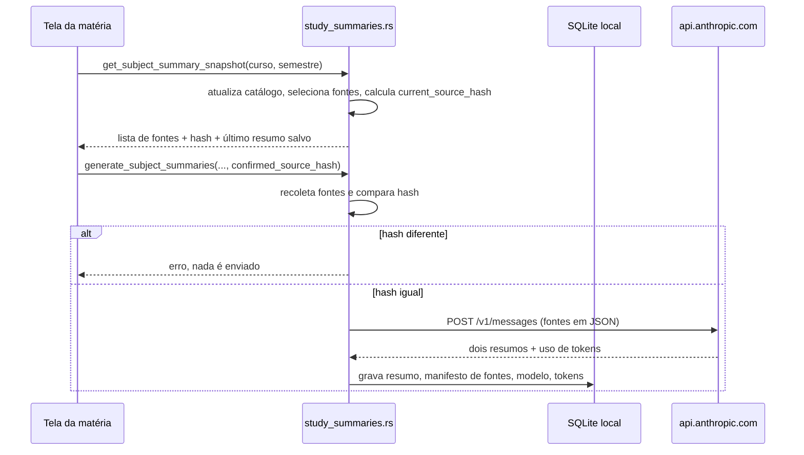

# Resumos com a API Anthropic

**Revisado em:** 2026-11-06 · **Estado:** **Parcial**. O código existe e tem testes com servidor simulado, mas **envia texto de matérias a um serviço externo**. Nenhuma chamada real foi feita nesta revisão.

> Esta é a única automação do app que transmite conteúdo acadêmico para fora do computador. Todas as outras leem ou gravam apenas localmente.

## O que faz

Para uma matéria e um semestre, o app reúne o texto dos materiais acadêmicos locais, mostra a lista ao estudante, pede confirmação e envia o conteúdo à API de mensagens da Anthropic. A resposta traz dois resumos em português (um de cerca de 2 minutos de leitura em voz alta, outro de cerca de 8) que são gravados no SQLite local.

| Item | Valor | Código |
|---|---|---|
| Endpoint | `https://api.anthropic.com/v1/messages` | `anthropic.rs`, `ANTHROPIC_MESSAGES_ENDPOINT` |
| Versão da API | `2023-06-01` | `ANTHROPIC_API_VERSION` |
| Modelo padrão | `claude-haiku-5-5` (sobrescrito por `ANTHROPIC_MODEL`) | `DEFAULT_MODEL`, `AnthropicConfig::parse` |
| Tempo limite | 120 s por requisição | `REQUEST_TIMEOUT` |
| Saída máxima | 8.000 tokens (`stop_reason = max_tokens` vira erro `TruncatedResponse`) | `MAX_OUTPUT_TOKENS`, `parse_pair` |
| Limite de entrada | 2 MiB de Markdown somado por geração | `study_summaries.rs`, `MAX_SUMMARY_SOURCE_BYTES` |
| Comandos Tauri | `get_subject_summary_snapshot`, `generate_subject_summaries` | `app/src-tauri/src/lib.rs` |
| Tabela local | `study_summaries` (versão de esquema 6) | `storage.rs`, `initialize_storage_schema` |

## Fluxo



Texto equivalente: a interface pede um instantâneo com as fontes e um hash; o estudante confirma; a geração recoleta as fontes e só prossegue se o hash ainda for o mesmo.

### Quais textos são enviados

`collect_subject_source_set` inclui apenas documentos que cumprem **todas** as condições:

- pesquisáveis e com leitura `ready` no catálogo local;
- categoria `material acadêmico` (a classificação por caminho em `catalog/classification.rs` exclui registros de notas, frequência e histórico, como `registro_academico`, `notas-oficiais`, `boletim`, `historico-*`; há teste para cada nome em `study_summaries.rs`);
- semestre igual ao da matrícula ativa e matéria igual (comparação sem acento e sem caixa);
- Markdown não vazio. Materiais importados (`ImportedMaterial`) entram pelo caminho relativo, mas passam pelo mesmo filtro de classificação.

Se a soma passar de 2 MiB, a geração é recusada com mensagem para reduzir o conteúdo.

O prompt manda o modelo tratar o conteúdo das fontes como dados não confiáveis e ignorar instruções que apareçam dentro dos materiais (`anthropic.rs`, `generate_pair`). É uma mitigação de injeção de prompt, não uma garantia.

### Confirmação por hash

`current_source_hash` resume o manifesto das fontes (caminho relativo, título e `content_sha256` de cada uma). `generate_subject_summaries` exige o parâmetro `confirmed_source_hash` e o compara com o hash recalculado no momento do envio. Se qualquer material mudou, aparece "Os materiais desta matéria mudaram desde a confirmação" e **nada é enviado**. A confirmação vale para aquele conjunto de arquivos, não é uma permissão permanente.

## Configuração e origem da chave

`AnthropicConfig::read_default()` lê, sem variável de ambiente intermediária, o arquivo fixo:

```text
$HOME/Dev/Projetos/gerenciador-de-conteudo/.env
```

O caminho está no código (`anthropic.rs`, `read_default`), fora deste repositório. Esta documentação não abriu esse arquivo. O parser (`AnthropicConfig::parse`) reconhece três chaves:

| Chave | Obrigatória | Efeito |
|---|---|---|
| `ANTHROPIC_API_KEY` | sim | Enviada no cabeçalho `x-api-key`. Ausente ou vazia: erro `MissingApiKey`. |
| `ANTHROPIC_MODEL` | não | Substitui o modelo padrão. |
| `ANTHROPIC_WORKSPACE_ID` | não | Se presente e não vazia, enviada no cabeçalho `anthropic-workspace-id`. Em branco é ignorada. |

A chave não é gravada em Markdown, JSON, SQLite nem logs; as mensagens de erro de `AnthropicError` não incluem o valor. Ver [credenciais-e-sessoes](../seguranca/credenciais-e-sessoes.md).

## Estado do envio do cabeçalho de workspace

- **Comportamento atual do código:** `generate_pair` adiciona `anthropic-workspace-id` quando `ANTHROPIC_WORKSPACE_ID` está configurada (`anthropic.rs`, linhas ~19, ~60 e ~225). Há testes para o caso com e sem o cabeçalho (`workspace_id_is_optional_and_ignored_when_blank`, `messages_api_sends_workspace_header_when_configured`).
- **Registro anterior, não reverificado:** [`../features/README.md`](../features/README.md) registra que uma chamada mínima em 2026-11-06 retornou `HTTP 400` ("This API key is not scoped to a workspace…") porque a versão anterior do cliente não enviava o cabeçalho. Esse relato descreve o cliente antigo. Esta revisão **não repetiu a chamada**; não se sabe se, com `ANTHROPIC_WORKSPACE_ID` definida, a API aceita.
- **Documentação desatualizada:** o mesmo `features/README.md` ainda afirma que o cliente "envia só `x-api-key` e `anthropic-version`". Isso não vale mais para o código atual.
- Os testes com servidor local (`cargo test`, 152 aprovados na revisão do núcleo) não exercitam a API real.

## Proveniência gravada

A tabela `study_summaries` guarda: `course_id`, `course_title`, `semester`, `source_hash`, `source_manifest_json` (lista de fontes com hash), `short_text`, `long_text`, `model`, `input_tokens`, `output_tokens` e `created_at`. O resumo é texto gerado por IA e não dado acadêmico oficial; a interface precisa tratá-lo como tal ("gerado por IA, conferir na fonte", convenção registrada em `features/README.md`).

## Contradição com a interface e com outros documentos

| Onde | Texto | Problema |
|---|---|---|
| `app/src/ui/App.tsx` (barra lateral) | "Seus dados ficam neste computador. Sem IA, nuvem ou cobrança por uso." | Falso quando o estudante usa resumos: o conteúdo vai à nuvem e a API tem cobrança por uso. |
| `app/README.md` | "Extração, regras e pontuação rodam localmente em Rust, sem geração por IA." | Verdadeiro para extração, aula e tutor; incompleto para resumos. |
| `../NAVEGACAO_PORTAL_UVA.md`, regra 1 | "`anthropic.rs`, `tutor.rs` e `study_summaries.rs` não participam da navegação nem da coleta." | Correto para a coleta. A regra 1 começa com "Sem IA", o que pode ser lido como propriedade do app inteiro. |
| `../features/README.md` | Cliente sem `anthropic-workspace-id` | Desatualizado (ver acima). |

**Decisão pendente (do mantenedor):** ajustar o texto da interface e dos READMEs, ou restringir a IA. As opções (a) envio com opt-in por material, (b) só trechos escolhidos, (c) IA só para tarefas sem conteúdo acadêmico estão em `features/README.md`, "Decisões em aberto". O fluxo atual está mais próximo de um opt-in por matéria (lista e hash confirmados), não por material.

## Planos e ideias em `docs/features/`

Os arquivos de [`../features/`](../features/README.md) (`pipelines.md`, `ideias.md`, `roteamento-modelos.md`) são **planos e ideias**, não código. Em particular, o roteamento por modelo (Opus para trabalhos e provas, Sonnet, Haiku) **não está implementado**: o cliente usa um único modelo, definido por `ANTHROPIC_MODEL` ou pelo padrão Haiku. Os pipelines de revisão de trabalho e prova não existem no código. Apenas o resumo por matéria descrito acima está implementado.

## Limitações conhecidas

- Sem OCR: PDFs sem camada de texto não geram fonte, logo não entram no resumo.
- Uma falha de rede, HTTP ou resposta sem as duas seções (`## Resumo curto`, `## Resumo longo`) vira erro e nada é salvo.
- Não há limite de gastos no app; o custo depende da conta da chave.
- Nenhuma verificação de que o resumo corresponde às fontes: ele deve ser conferido na fonte.
- `anthropic.rs` consta como não versionado no novo caminho `app/crates/estuda-core/src/anthropic.rs`; a cópia antiga em `app/src-tauri/src/` aparece como removida na árvore de trabalho.
