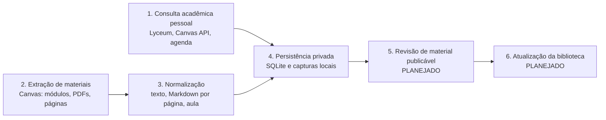

# Automações: visão geral

**Revisado em:** 2026-11-06 · **Base:** commit `3811300` mais a árvore de trabalho não commitada (núcleo extraído para `app/crates/estuda-core/`).

Este documento descreve o que o Estuda UVA faz sozinho, de onde vêm os dados e o que nunca é feito. Cada afirmação aponta para o código. Marcadores de estado usados em toda a pasta:

| Marcador | Significado |
|---|---|
| **Implementado** | Existe código e teste offline no checkout. Não prova que a leitura já rodou numa sessão autenticada real. |
| **Parcial** | Existe código, mas com lacuna conhecida (descrita no texto). |
| **Planejado** | Não existe código. Aparece só em planos. |
| **Não verificado** | Existe, mas esta revisão não conseguiu confirmar o comportamento. |

## Garantias gerais

O app **não envia atividades, não agenda nem cancela provas, não posta em fóruns, não abre protocolos, não faz matrícula e não altera nenhum registro institucional**. O código só lê. As proteções que sustentam isso estão em [limites-e-seguranca.md](limites-e-seguranca.md). Os passos que alteram estado (entregar AVA, agendar prova, abrir protocolo) estão em [`../NAVEGACAO_PORTAL_UVA.md`](../NAVEGACAO_PORTAL_UVA.md) como **manuais**: o estudante faz, o app não automatiza.

Outras garantias comuns:

- **Login sempre manual.** O estudante digita CPF, senha e MFA na janela Chromium visível do app. Nenhum módulo lê, pede ou grava senha (`browser.rs`, `CanvasSession::launch` usa `with_head()` e um perfil dedicado).
- **Captura nova é arquivo novo.** `lyceum::write_new_file_beneath` usa `create_new(true)`: se o arquivo existe, falha e preserva o anterior (`app/crates/estuda-core/src/lyceum.rs`).
- **URLs gravadas perdem query, fragmento e userinfo** antes de irem para Markdown, JSON ou SQLite.
- **Cookies e URLs assinadas ficam só em memória** durante a requisição.

## Integrações

| Integração | Sistema de origem | Método | Estado | Documento |
|---|---|---|---|---|
| Portal do Aluno / Lyceum | `portalaluno.uva.br`, `sis.lyceum.com.br`, `*.uva.br` | Chromium (CDP), leitura de HTML | **Implementado** (captura completa autenticada não executada) | [portal-lyceum.md](portal-lyceum.md) |
| Canvas: inventário e materiais | `uva.instructure.com` | Chromium (HTML) + `reqwest` para o PDF | **Implementado** | [canvas.md](canvas.md) |
| Canvas: notas, fóruns, avisos, Caixa de Entrada | `uva.instructure.com/api/v1` | `fetch` dentro da página autenticada | **Implementado** (nenhuma leitura autenticada executada) | [canvas.md](canvas.md) |
| Agenda de prazos | Canvas (tarefas publicadas) | `fetch` da API de tarefas | **Implementado** | [calendario.md](calendario.md) |
| Extração de texto | arquivos locais | `pdf-extract`, `docx-lite`, `iwork`, `scraper` | **Implementado** (sem OCR) | [extracao-textual.md](extracao-textual.md) |
| Aula guiada e tutor | texto local já extraído | regras determinísticas em Rust | **Implementado** | [extracao-textual.md](extracao-textual.md) |
| Resumos com IA | API Anthropic | `reqwest` para `api.anthropic.com` | **Parcial**: envia conteúdo a serviço externo; contradiz a UI | [resumos-anthropic.md](resumos-anthropic.md) |
| Sistema de Provas (SGP), Zeev, Pagamento | hosts ainda não observados/permitidos | nenhum | **Planejado** só leitura; o app não navega nesses sistemas | [`../NAVEGACAO_PORTAL_UVA.md`](../NAVEGACAO_PORTAL_UVA.md) |

## Os seis fluxos

Os dados passam por seis etapas distintas. As quatro primeiras existem em código; as duas últimas ainda não.

Texto equivalente ao diagrama: a consulta pessoal (1) e a extração de materiais (2) produzem dados brutos; a normalização (3) transforma materiais em Markdown; tudo é gravado localmente (4). Revisão (5) e atualização da biblioteca pública (6) não têm código.

| # | Fluxo | O que faz | Estado | Código principal |
|---|---|---|---|---|
| 1 | Consulta acadêmica pessoal | Lê histórico, notas, frequência (Lyceum), notas e feedback das AVAs, fóruns, avisos e Caixa de Entrada (Canvas), prazos | **Implementado** | `lyceum.rs`, `canvas_api.rs`, `calendar.rs`, `browser.rs` |
| 2 | Extração de materiais | Enumera módulos, localiza PDFs e páginas, baixa o PDF com limites | **Implementado** | `canvas.rs`, `canvas_capture.rs`, `download.rs`, `browser.rs` |
| 3 | Normalização de conteúdo | PDF/página para Markdown por página, hash do texto, aula guiada, perguntas | **Implementado** | `pdf.rs`, `archive.rs`, `lesson.rs`, `tutor.rs`, `catalog/documents.rs` |
| 4 | Persistência privada | Grava Markdown no acervo, metadados no SQLite local, capturas em `materias/catalogo/capturas/` (caminho gravado pelo código; ignorado pelo Git hoje, alinhamento à política de publicação pendente) | **Implementado** | `archive.rs`, `storage.rs`, `lyceum::persist_capture`, `canvas_api::persist_capture` |
| 5 | Revisão de material publicável | Uma pessoa decide o que pode ir para a biblioteca pública | **Planejado**: não há fluxo de código. A fronteira por caminho existe em `crates/estuda-domain/src/publication.rs`, mas nada a conecta a uma tela ou comando | [`../seguranca/publicacao.md`](../seguranca/publicacao.md) |
| 6 | Atualização da biblioteca | Distribuir e atualizar offline um banco/biblioteca pública | **Planejado**: o banco público não existe | [`../dados/banco-publico.md`](../dados/banco-publico.md) |

Nota sobre o fluxo 4: `refresh_indexes` em `archive.rs` reescreve apenas a seção entre `<!-- estuda-uva:start -->` e `<!-- estuda-uva:end -->` dos `README.md` de `materias/`, preservando o texto manual fora dela.

## Concorrência e cancelamento

- Um `Mutex` (`canvas_operation`) em `AppState` serializa operações que usam a janela do Chromium (`app/src-tauri/src/lib.rs`).
- Capturas em lote e importações individuais guardam um `watch::Sender<bool>` em `active_captures` / `active_imports`. Os comandos `cancel_canvas_capture` e `cancel_import` enviam `true`; os laços checam o sinal entre etapas e `download_pdf` o observa dentro de `tokio::select!` durante a conexão e a leitura do corpo.
- Só uma captura em lote roda por vez (`start_canvas_capture` recusa se `active_captures` não está vazio).

## Divergências com a documentação existente

- `../NAVEGACAO_PORTAL_UVA.md` cita caminhos `app/src-tauri/src/*.rs`. Esses arquivos foram movidos para `app/crates/estuda-core/src/` (a árvore de trabalho mostra os antigos como removidos). O conteúdo funcional continua válido; os caminhos, não.
- A regra 1 desse guia ("Sem IA") vale para navegação e coleta. Não vale para o app como um todo: `study_summaries.rs` envia texto a uma API externa. Ver [resumos-anthropic.md](resumos-anthropic.md).
- A regra 2 diz que o app não "reaproveita cookies". O app não **grava** cookies, mas `CanvasSession::cookies_for_host` lê os cookies do Chromium via CDP e os passa, só em memória, ao `reqwest` para baixar o PDF. Ver [canvas.md](canvas.md).
- O caminho `materias/catalogo/capturas/` está fixo no código. Se a reorganização para `privado/` pretende mover as capturas, o código precisa mudar. Ver [limites-e-seguranca.md](limites-e-seguranca.md).
