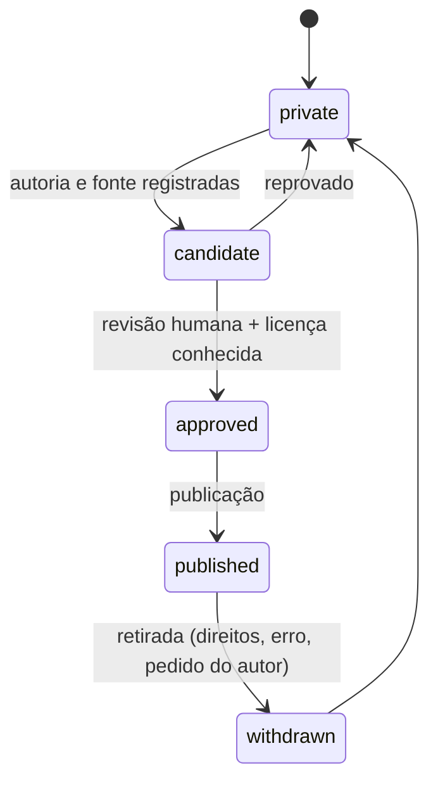

# Catalogação: contrato de metadados (PROPOSTA)

**Revisado em:** 2026-11-06 · **Estado:** **Planejado**. Nada neste documento descreve um esquema existente.

> Os campos abaixo são uma **proposta de contrato** para uma futura biblioteca pública. Nenhum arquivo do repositório tem hoje esta forma, nenhum validador a exige e nenhum banco a armazena. Os registros reais de `dados/` seguem outro formato, resumido em §6.

## 1. Objetivo

Dar a cada material publicável (texto de disciplina, exercício, enunciado, solução autorizada etc.) uma ficha de metadados que permita encontrá-lo, verificar a origem, conferir a integridade e decidir se pode ser publicado. A ficha é um arquivo JSON UTF-8 ao lado do conteúdo em Markdown, no mesmo princípio de "um registro por arquivo" de [../../dados/LEIA-ME.md](../../dados/LEIA-ME.md).

## 2. Campos propostos

Todos os campos abaixo foram pedidos para o contrato. `?` marca campo opcional; ausência é `null` com pendência registrada, como já exige o validador atual para `dados/`.

| Campo | Tipo | Regra proposta |
|---|---|---|
| `id` — identificador estável | string | `<namespace>:<tipo>:<slug>`, minúsculas, `[a-z0-9:_.-]`, até 200 caracteres (mesma regra de `crates/estuda-domain/src/ids.rs`). Nunca reutilizado nem renomeado. |
| `title` — título | string | Texto livre em UTF-8, sem quebra de linha. |
| `materialType` — tipo de material | enum | `discipline`, `content`, `exercise`, `exam`, `assignment`, `solution`, `reference`. Ver [tipos-de-conteudo.md](tipos-de-conteudo.md). |
| `disciplineId` — disciplina | string | `id` de `dados/disciplinas/*.json` (ex.: `uva:discipline:calculo-numerico`). |
| `programIds` — curso relacionado | lista de string | `id` de `dados/programas/*.json`. |
| `institutionId` — instituição, quando aplicável | string? | `id` de `dados/instituicao/*.json`. |
| `subject` — assunto | string | Tópico principal em texto livre. |
| `tags` | lista de string | Minúsculas, sem acentos, hifenizadas. |
| `authorship` — autoria | objeto | `kind` (`original`, `adapted`, `third_party`), `credit` (texto de crédito), `consent` (ver [fontes-e-licencas.md](fontes-e-licencas.md)). Sem dados pessoais reais em exemplos; para colaborador real, usar pseudônimo ou nome autorizado por escrito. |
| `source` — fonte original | objeto | Mesmos campos do `source` atual: `file`, `section`, `observedAt`; mais `kind` (`official`, `own`, `third_party`). |
| `originRef` — referência de origem | string? | URL oficial **sem query nem fragmento**, ou citação bibliográfica. Nunca URL com token. |
| `sourceDate` — data da fonte | string? | ISO 8601 `YYYY-MM-DD`; `null` com pendência se desconhecida. |
| `collectedAt` — data de coleta | string | ISO 8601 com fuso, ex.: `2026-11-06T12:00:00Z`. |
| `version` | string | `MAJOR.MINOR` do próprio material; incrementa a cada mudança de conteúdo. |
| `integrity` — hash de integridade | objeto | `algorithm` = `sha256`, `contentSha256` = hash hexadecimal do arquivo de conteúdo em UTF-8. |
| `language` | string | BCP 47, ex.: `pt-BR`. |
| `format` | string | `markdown`, `json` ou `text`. Binários não entram no Git. |
| `license` — licença | objeto | `spdx` (identificador SPDX ou `NOASSERTION`), `holder`, `terms` (texto curto). Desconhecida = `NOASSERTION`, que implica **não publicável**. |
| `verification` — status de verificação | enum | `unverified`, `source_checked`, `reviewed`, `disputed`. |
| `publication` — status de publicação | enum | `private`, `candidate`, `approved`, `published`, `withdrawn`. |

### Regras de consistência propostas

1. `publication = published` só é válido com `license.spdx` diferente de `NOASSERTION`, `verification = reviewed` e `authorship.consent` registrado quando `authorship.kind` não for `third_party` oficial.
2. `integrity.contentSha256` deve bater com o arquivo; divergência vira `verification = disputed`.
3. `id` não identifica pessoa: não usa RA, CPF, RG, e-mail nem telefone (dados que seguem fora até decisão do dono). Notas, frequência e matrículas podem ir ao acervo pela decisão de 6/11/2026, desde que estejam em `privado/`; se ganham ficha de biblioteca, é decisão pendente (§7).
4. `publication` só avança por revisão humana (ver [../contribuindo/conteudo.md](../contribuindo/conteudo.md)); o contrato `estuda-domain::publication` já nega por padrão (ver [estrutura.md](estrutura.md) §3).

## 3. Estados



O diagrama mostra que todo material começa privado, só passa para candidato com fonte e autoria e só chega a publicado depois de aprovação humana. Retirada é sempre possível.

## 4. Exemplo SINTÉTICO

Dados fictícios; `uva:` é só o prefixo de namespace do repositório. O conteúdo referenciado não existe.

```json
{
  "id": "uva:exercise:exemplo-derivada-polinomio-01",
  "title": "Derivada de um polinômio (exercício de exemplo)",
  "materialType": "exercise",
  "disciplineId": "uva:discipline:exemplo-calculo",
  "programIds": ["uva:program:exemplo-programa"],
  "institutionId": "uva",
  "subject": "Derivadas",
  "tags": ["derivada", "polinomio", "exemplo"],
  "authorship": { "kind": "original", "credit": "Contribuidor de exemplo", "consent": "registrado em revisão fictícia 0001" },
  "source": { "file": "docs/biblioteca/catalogacao.md", "section": "Exemplo", "observedAt": "2026-11-06", "kind": "own" },
  "originRef": null,
  "sourceDate": null,
  "collectedAt": "2026-11-06T12:00:00Z",
  "version": "1.0",
  "integrity": { "algorithm": "sha256", "contentSha256": "0000000000000000000000000000000000000000000000000000000000000000" },
  "language": "pt-BR",
  "format": "markdown",
  "license": { "spdx": "NOASSERTION", "holder": null, "terms": null },
  "verification": "unverified",
  "publication": "private",
  "pendencias": [
    { "campo": "originRef", "motivo": "exercício original, sem origem externa" },
    { "campo": "sourceDate", "motivo": "sem data de fonte externa" },
    { "campo": "license.holder", "motivo": "licença ainda não escolhida" },
    { "campo": "license.terms", "motivo": "licença ainda não escolhida" }
  ]
}
```

O hash de zeros é um marcador de exemplo, não um hash real. O exemplo foi validado como JSON (parser Python `json.loads`) em 2026-11-06; isso comprova a sintaxe, não a conformidade com o contrato, que não tem validador.

## 5. Como esta proposta se relaciona com o que existe

| Proposta | Equivalente atual |
|---|---|
| `id` | `id` em `dados/**` (`uva:discipline:…`, `uva:program:…`) |
| `source` | `source.file`, `source.section`, `source.observedAt` |
| `pendencias` | `pendencias: [{ campo, motivo }]` |
| `integrity` | `sha256` e `text_sha256` em `materials` do banco privado do app (`app/crates/estuda-core/src/storage.rs`); não há hash em `dados/` |
| `license`, `authorship`, `publication`, `verification`, `language`, `version` | **não existem** hoje |

## 6. Formato real dos registros de `dados/` (existente)

Exemplo estrutural de `dados/disciplinas/*.json` (valores abreviados): `id`, `title`, `offeringIds`, `identityStatus`, `source { file, section, observedAt }`, `ordem`, `pendencias`. Os campos de `dados/ofertas/` são `id`, `code`, `title`, `workloadHours`, `status`, `canonicalDisciplineId`, `source`, `programId`, `ordem`, `pendencias`. A referência completa está em [../../dados/LEIA-ME.md](../../dados/LEIA-ME.md) e as regras em `tools/acervo/src/validar.mjs`.

## 7. Decisões pendentes

1. Escolha de licença padrão para conteúdo próprio (nenhuma está declarada; ver [fontes-e-licencas.md](fontes-e-licencas.md)).
2. Onde ficam as fichas: ao lado do conteúdo ou em `schemas/`/`biblioteca/` centralizados.
3. Se o gerador passa a validar este contrato (hoje não valida).
4. Se notas, frequência e matrículas (permitidas no acervo pela decisão de 6/11/2026, desde que em `privado/`) terão ficha de biblioteca.
5. Nomes de docentes e de outros colaboradores ou terceiros: continuam fora da camada pública até decisão do dono (ver [lacunas-e-contradicoes.md](../referencia/lacunas-e-contradicoes.md) §1).
