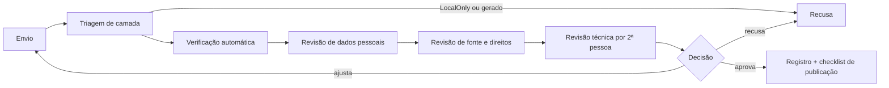

# Como contribuir com conteúdo

**Revisado em:** 2026-11-06 · **Estado:** o repositório é **local, sem remoto**, e **não há biblioteca pública publicada**. Este guia define como preparar contribuições de forma que possam ser revisadas e, no futuro, publicadas. O processo é **documental**: não há automação de revisão nem modelo de pull request hoje (**Planejado**).

Licença: **nenhuma licença declarada** ([../biblioteca/fontes-e-licencas.md](../biblioteca/fontes-e-licencas.md)). Enquanto não houver, contribuições externas só devem ser aceitas com consentimento escrito do autor, registrando que a licença futura será a escolhida pelo mantenedor.

## 1. Proibições (valem para toda contribuição)

Uma contribuição **não pode conter**:

- RA, CPF, RG, e-mail, telefone ou nome completo de colegas, ou de qualquer pessoa sem autorização de publicação. RA, CPF e RG ficam fora do repositório para todos (decisão do dono, 6/11/2026);
- notas, frequência, matrícula, trajetória, boletim ou capturas autenticadas do Portal/Canvas **de outra pessoa**;
- credenciais, cookies, tokens, chaves de API, URLs com `?token=`, `signature` ou parâmetros de SSO;
- caminhos absolutos da máquina de alguém (`/Users/…`, `/home/…`);
- nomes de docentes (dado de terceiros; ficam fora da camada pública);
- material acadêmico não autorizado: provas e avaliações em aberto, materiais de terceiros sem licença ou permissão, PDFs e imagens (binários não entram no Git);
- solução de avaliação em andamento.

Dados pessoais do próprio aluno (matrícula, notas, frequência, trajetória, trabalhos entregues e planejamento) não estão nesta lista: pela decisão do dono de 6/11/2026, podem ir ao acervo quando estão em `privado/`. Essa exceção não cobre dados de terceiros nem os demais itens acima.

Em caso de dúvida sobre a camada, trate como privado e pergunte antes de enviar.

## 2. Regras comuns

1. **Texto, não binário.** PDF e documentos viram Markdown com página e fonte; diagramas viram Mermaid ou descrição textual (`AGENTS.md`).
2. **Um registro por arquivo**, nome igual ao slug do `id` (`dados/LEIA-ME.md`).
3. **Toda informação tem fonte** (arquivo existente, seção, data `YYYY-MM-DD`). Campo ausente é `null` com pendência; nunca `""` nem `0`, nunca valor inventado.
4. **Confirmado, estimado e desconhecido são coisas diferentes.** Não promova estimativa a dado oficial.
5. **Não reescreva** registros de outras pessoas para "arrumar" formatação; mude só o que verificou.
6. **Não renomeie `id`s** existentes: outros registros os referenciam.
7. **UTF-8, Markdown e JSON; datas ISO 8601** (`YYYY-MM-DD` ou com fuso); exemplos com dados sintéticos.
8. **Antes de enviar:** `node tools/acervo/build.mjs --validar` e `node tools/acervo/build.mjs --verificar-texto` devem passar sem erro. Esses comandos **não** substituem a revisão humana (não cobrem Markdown livre).
9. **Declare autoria e consentimento** no envio: você é o autor ou tem direito de publicar, e concorda com a licença que o mantenedor escolher.

## 3. Por tipo de contribuição

### 3.1 Código Rust

Siga [../desenvolvimento/contribuindo-codigo.md](../desenvolvimento/contribuindo-codigo.md). Em particular: mudança no banco (tabela, migração, `INSERT`, `UPDATE`) exige proposta e aprovação prévia do mantenedor, com SQL, justificativa e impacto, antes de qualquer arquivo de migração. Não coloque dados reais em testes; use dados sintéticos.

### 3.2 Correções documentais

- Edite o arquivo em `docs/`; mantenha links relativos funcionando e cite o caminho do código que fundamenta a afirmação.
- Marque o estado: **Implementado**, **Parcial**, **Planejado** ou **Não verificado**. Não descreva como disponível o que não existe.
- Documentos de `docs/superpowers/` são planos e especificações históricas; não os reescreva para "atualizar" o passado, adicione nota de revisão.

### 3.3 Conteúdo de disciplinas

- Campos: título, ementa, competências, tópicos, pré-requisitos ([../biblioteca/tipos-de-conteudo.md](../biblioteca/tipos-de-conteudo.md) §1).
- Fonte: a matriz curricular oficial ou o plano de ensino citado por arquivo e seção.
- Equivalência entre cursos **nunca** é inferida; use "candidata" até haver fonte oficial.
- Sem nomes de docentes.

### 3.4 Exercícios

- Enunciado próprio ou com permissão registrada; alternativas numeradas; dificuldade e assunto indicados.
- Resposta correta e resolução em arquivo separado do enunciado.
- Não copie enunciados de livros ou provas de terceiros sem licença.

### 3.5 Resoluções (soluções)

- Autoria declarada e consentimento de publicação.
- Explique o raciocínio, cite as fontes e revise antes de pedir publicação.
- Nunca resolva avaliação em aberto nem trabalho em andamento de outra pessoa.

### 3.6 Materiais bibliográficos

- Registre referência completa (autor, título, edição, ano) ou URL oficial **sem query nem fragmento**.
- Não anexe PDF nem imagem; registre o link e, se for texto extraído, a página e o aviso de direitos.
- Texto extraído integral de e-book de terceiro só entra se houver licença ou permissão ([../biblioteca/fontes-e-licencas.md](../biblioteca/fontes-e-licencas.md) §3).

### 3.7 Correções de metadados

- Aponte o registro (`id`), o campo, o valor atual, o valor proposto e a **fonte** que o sustenta.
- Se a fonte não existe no repositório, adicione-a como texto antes de alterar o registro.
- Se duas fontes divergem, registre o conflito com ambas e uma pendência; não escolha uma sozinho.
- Mantenha as representações SQLite, Markdown e JSON coerentes e preserve conflitos para revisão humana (`AGENTS.md`).

### 3.8 Traduções

- Preserve o sentido e a terminologia do glossário ([../referencia/glossario.md](../referencia/glossario.md)).
- Indique o idioma na ficha (`language`, BCP 47) e a fonte original; a tradução é obra derivada e herda as restrições de licença da origem.
- Traduções de textos de terceiros dependem de permissão do titular.

## 4. Processo de revisão de conteúdo público (documental)

Aplica-se a tudo que se pretende tornar público. **Planejado**: hoje a revisão é feita manualmente pelo mantenedor.

1. **Envio.** O contribuidor descreve o conteúdo, o tipo (§3), as fontes, a autoria e o consentimento; confirma que leu as proibições (§1).
2. **Triagem de camada.** O revisor classifica os caminhos conforme [../biblioteca/estrutura.md](../biblioteca/estrutura.md) §3. `LocalOnly` e `Generated` são recusados. `Personal` segue só se a política do dono o autoriza (decisão de 6/11/2026). Caminhos em `NeedsReview` seguem para o passo seguinte.
3. **Verificação automática.** Rodar `--validar` e `--verificar-texto`; registrar o resultado.
4. **Revisão de dados pessoais.** Busca manual por identificadores, nomes de terceiros, URLs com segredo e caminhos absolutos ([privacidade.md](../seguranca/privacidade.md) §7).
5. **Revisão de fonte e direitos.** Conferir fonte, licença e permissão; sem licença conhecida, o material fica `private`.
6. **Revisão técnica do conteúdo.** Uma segunda pessoa confere a correção (fórmulas, enunciados, soluções).
7. **Decisão.** Aprovar, pedir alterações ou recusar, com motivo registrado.
8. **Registro.** Anotar revisor, data, resultado e hash do commit. Estado `approved` só depois dos passos 1 a 7.
9. **Publicação.** Segue o checklist de [../seguranca/publicacao.md](../seguranca/publicacao.md); nada é publicado sem confirmação explícita do mantenedor.
10. **Retirada.** Pedido do autor, da instituição ou de um docente interrompe a publicação e remove o material da próxima versão.

O diagrama resume o fluxo: a triagem recusa o que é `LocalOnly` ou gerado, as revisões acontecem em sequência e só uma aprovação registrada leva ao checklist de publicação.

## 5. Onde pedir ajuda

Dúvidas sobre camada, licença ou publicação são decisões do mantenedor (ver "Decisões pendentes" em [../seguranca/publicacao.md](../seguranca/publicacao.md) §7).
