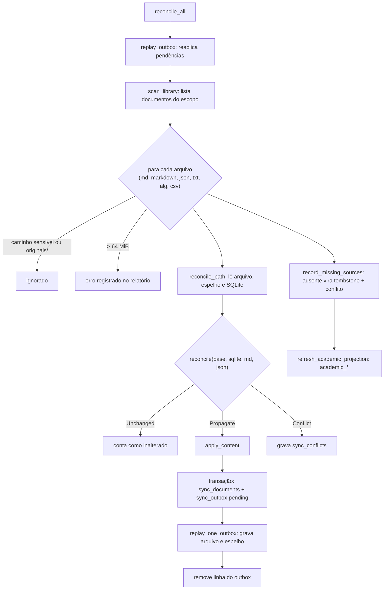

# Sincronização e conflitos

**Revisado em:** 2026-11-06 · **Base:** commit `3811300` mais árvore de trabalho não commitada.

Este documento descreve como o aplicativo mantém três representações de um mesmo documento (SQLite, Markdown e JSON) coerentes, e como preserva divergências para revisão humana, conforme `AGENTS.md`. Tudo foi lido em `app/crates/estuda-core/src/sync.rs` e `sync_watcher.rs`. A sincronização opera sobre **arquivos de texto do acervo**; não toca sistemas da UVA.

Relacionados: [visão geral](visao-geral.md) · [banco privado](banco-privado.md) · [migrações](migracoes.md).

> Nada aqui autoriza executar SQL. A sincronização escreve no banco do app porque é uma função do aplicativo; documentar isso não dá permissão a agentes ou scripts para alterar o banco.

## 1. As três superfícies

Para cada documento sincronizado, `reconcile_path` compara três valores de texto:

| Superfície | Fonte `.md`, `.markdown`, `.txt`, `.alg`, `.csv` | Fonte `.json` |
|---|---|---|
| **SQLite** | `sync_documents.content` | `sync_documents.content` |
| **Markdown** | o próprio arquivo | espelho `.estuda-uva/mirrors/<caminho>.md` (JSON dentro de um bloco de código) |
| **JSON** | espelho `.estuda-uva/mirrors/<caminho>.json` (envelope com o texto no campo `content`) | o próprio arquivo |

Nomes dos espelhos (`mirror_relative_path`): para fonte JSON acrescenta-se `.md`; para as demais acrescenta-se `.json`. Exemplo: `materias/aula.md` tem espelho `.estuda-uva/mirrors/materias/aula.md.json`; `materias/catalogo/capturas/lyceum/registro.json` tem espelho `.estuda-uva/mirrors/materias/catalogo/capturas/lyceum/registro.json.md`.

Quem edita o quê: a pessoa edita o arquivo-fonte ou um espelho; o app grava o SQLite (`set_content`) e **escreve de volta** nas outras superfícies.

### Envelope JSON do espelho (fonte não-JSON)

Campos produzidos por `json_envelope_projection` (esquema 1). Chaves extras que já existiam no espelho são preservadas. Exemplo sintético:

```json
{
  "schemaVersion": 1,
  "id": "doc-0000000000000000000000000000000000000000000000000000000000000000",
  "kind": "md_document",
  "relativePath": "materias/exemplo/aula.md",
  "revision": 3,
  "contentHash": "1111111111111111111111111111111111111111111111111111111111111111",
  "updatedAt": "1793900000",
  "content": "# Aula de exemplo\n\nTexto sintético.\n"
}
```

- `id` é `doc-` seguido do SHA-256 do caminho relativo (`stable_id`).
- `kind` é `<formato>_document`.
- `contentHash` é o SHA-256 do conteúdo.
- `updatedAt` é um instante Unix em **segundos, como texto** (`timestamp()`), diferente das datas ISO usadas nos registros de `dados/`.
- Na leitura, `parse_json_envelope` exige `schemaVersion = 1`, `relativePath` igual ao do documento e, quando o documento já existe, o mesmo `id`. Caso contrário recusa o espelho sem sobrescrever nada.

### Projeção Markdown de um JSON

`json_markdown_projection` gera: título `# <nome do arquivo>`, o marcador `<!-- estuda-uva-json final-newline=0|1 -->` e o conteúdo dentro de um bloco ```` ```json ````. O cercado cresce se o JSON contiver crases. `decode_json_markdown` faz o caminho inverso e valida que o resultado é JSON.

## 2. Tabelas da sincronização

Criadas por `initialize_sync_schema` no mesmo `.estuda-uva.sqlite3` do aplicativo (WAL, `foreign_keys=ON`).

| Tabela | Colunas | Papel |
|---|---|---|
| `sync_documents` | `id` (PK), `relative_path` (único), `format`, `content`, `base_content`, `revision`, `content_hash`, `updated_at` | cópia SQLite do documento e a **base** do último estado coerente (`base_content`) |
| `sync_conflicts` | `relative_path` (PK), `base_content`, `sqlite_value`, `markdown_value`, `json_value`, `created_at` | uma linha por documento em conflito, com as três versões |
| `sync_tombstones` | `relative_path` (PK), `format`, `content`, `created_at` | arquivo que sumiu; guarda o último conteúdo para restauração |
| `sync_outbox` | `relative_path` (PK), `source_expected_hash`, `mirror_expected_hash`, `source_projection`, `mirror_projection`, `revision`, `state` (`pending` ou `conflict`) | gravação em duas fases: o que será escrito e os hashes esperados antes |

`sync_conflicts` guarda **no máximo uma linha por caminho**: um novo conflito do mesmo caminho substitui o anterior.

## 3. Algoritmo de reconciliação

A função pura `reconcile(base, sqlite, markdown, json)` decide a partir de quatro entradas. Cada superfície é `Value(texto)`, `Missing` ou `Tombstone`.

1. Considera-se **mudança** toda superfície que não é `Missing` e cujo valor difere de `base`. `Tombstone` conta como mudança "apagar".
2. Sem mudanças: `Unchanged`.
3. Todas as mudanças iguais: `Propagate(valor)` (ou `Delete` se a mudança comum é apagar).
4. Mudanças diferentes entre si: `Conflict` com as três superfícies. **Nenhuma versão vence sozinha.**

Consequências práticas:

- Editar só uma superfície propaga para as outras duas.
- Editar duas superfícies para o **mesmo** texto também propaga (sem conflito).
- Editar duas superfícies para textos diferentes gera conflito.
- Um documento novo (sem base) com apenas o arquivo presente cria o registro e o espelho.
- `Delete` **não é aplicado**: o resultado vira uma mensagem em `SyncReport.errors` ("tem uma solicitação de exclusão explícita pendente"). O conteúdo nunca é apagado pela reconciliação.



Leitura: a reconciliação inteira roda em ordem: reaplicar pendências do `sync_outbox`, escanear, reconciliar cada arquivo, registrar fontes sumidas e, por fim, refazer a projeção `academic_*` a partir dos cinco JSON do catálogo.

## 4. Gravação em duas fases (outbox)

`apply_content` abre uma transação que faz duas coisas: grava `sync_documents` (conteúdo e base iguais ao novo texto, `revision + 1`, `content_hash`) e insere em `sync_outbox` o que deve ser escrito (`source_projection`, `mirror_projection`) com os hashes esperados dos arquivos atuais. Depois da confirmação, `replay_one_outbox` escreve os arquivos.

`write_projection` só substitui um arquivo se ele ainda tem o hash esperado (ou já tem o conteúdo-alvo, ou não existe). Escreve em arquivo temporário `.estuda-sync-<uuid>.tmp` na mesma pasta, faz `sync_all` e `rename`. Se o arquivo mudou depois da leitura, **não sobrescreve**: marca a linha do outbox como `conflict`, grava `sync_conflicts` e devolve erro.

Efeito: se o processo for interrompido entre as duas fases, o `sync_outbox` mantém `state='pending'` e a próxima `reconcile_all` reaplica (teste `interrupted_projection_is_replayed_after_reopening_the_database`).

## 5. Exclusões e tombstones

`record_missing_sources` compara os documentos conhecidos no SQLite com os que o escaneamento encontrou. Para cada um que sumiu:

1. cria `sync_tombstones` com o último conteúdo;
2. cria um conflito com `base = conteúdo`, SQLite com o conteúdo e a superfície do arquivo ausente (`Missing`).

O conteúdo **nunca é descartado em silêncio**: a interface mostra um conflito de restauração (`SyncConflict.tombstone = true`). Se o arquivo reaparece, a próxima `reconcile_path` apaga o tombstone e o conflito e reconcilia normalmente. Testes: `deleting_a_source_keeps_its_content_and_exposes_a_restoration_conflict` e `resolving_a_tombstone_restores_the_source_and_clears_recovery_state`.

## 6. Resolução de conflitos

`resolve_conflict(caminho, conteúdo)`, chamado por `resolve_local_sync_conflict`:

1. exige que o arquivo exista **ou** que haja tombstone a restaurar;
2. aceita para fonte JSON tanto o JSON quanto a projeção Markdown (tenta decodificar o Markdown se o texto não for JSON);
3. recusa JSON inválido sem alterar nada;
4. aplica o conteúdo escolhido com `apply_content` (refaz arquivo, espelho e SQLite) e remove `sync_conflicts` e `sync_tombstones` daquele caminho.

A interface mostra as três versões (`SyncConflict.sqlite`, `markdown`, `json`) e envia o texto final escolhido pela pessoa. Não há fusão automática de linhas.

## 7. Edições feitas pelo aplicativo

| Operação | Função | Efeito |
|---|---|---|
| Sincronizar agora | `reconcile_all` (comando `sync_local_catalog`) | percorre todo o escopo |
| Editar documento sincronizado | `set_content` + `reconcile_all` (comando `edit_synced_document`) | atualiza só `sync_documents.content` e deixa a reconciliação propagar para arquivo e espelho; recusa JSON inválido e documento desconhecido |
| Criar documento novo | `create_content` | recusa caminho sensível, formato não aceito e JSON inválido; escreve o arquivo com `create_new` (não substitui existente) e reconcilia |
| Resolver conflito | `resolve_conflict` (comando `resolve_local_sync_conflict`) | seção 6 |
| Alteração de arquivo na pasta | monitor `SyncWatcher` | chama `reconcile_all` depois de 500 ms sem novos eventos |

## 8. Escopo, limites e segurança

- **Formatos aceitos:** `md`, `markdown`, `json`, `txt`, `alg`, `csv` (`reconcile_all`). O monitor reage a `md`, `markdown`, `txt`, `alg`, `csv`, `json` (`SYNCABLE_EXTENSIONS`).
- **Tamanho:** máximo de 64 MiB por arquivo e por conteúdo (`MAX_SYNC_FILE_BYTES`).
- **Codificação:** o arquivo precisa estar em UTF-8; JSON precisa ser válido, senão "os últimos dados válidos foram preservados".
- **Caminhos:** relativos, sem `..`, sem raiz; qualquer componente que seja link simbólico é recusado (`safe_existing_path`, `read_optional_safe`); o caminho canônico precisa estar dentro do acervo.
- **Exclusões por nome:** caminhos que começam com `originais/` ou têm segmento contendo `senha`, `password`, `credential`, `credencial`, `cookie`, `token` ou `secret` não entram (`is_sensitive_or_excluded`).
- **Escopo de pastas** (`catalog/scanner.rs`, `is_in_scope_file`): `docs/` (exceto `docs/superpowers/`), `materias/`, `originais/` (excluído depois por `is_sensitive_or_excluded`), `fontes-uva/`, `periodos/`, `cursos/` e alguns arquivos de registro na raiz. **`privado/` e `dados/` não estão no escopo** e, portanto, não são sincronizados (lacuna L2 em [visão geral](visao-geral.md)).
- **Monitor:** observa a raiz sem recursão e `materias/` e `docs/` com recursão (`WatchSet::from_root`). Mudanças em `fontes-uva/`, `periodos/` ou `cursos/` só são vistas na próxima sincronização manual ou no próximo evento de uma pasta observada. Ignora eventos de acesso e qualquer caminho com segmento iniciado por `.` (o que inclui os espelhos em `.estuda-uva/` e os temporários `.estuda-sync-*.tmp`). Alterações no próprio `.estuda-uva.sqlite3` e em seus `-wal`, `-shm` e `-journal`, na raiz, **são** consideradas relevantes (`is_relevant_path`); isso permite notar edições externas no banco, mas o código lido não explica como evita reconciliações repetidas causadas pelas escritas do próprio app (**não verificado**).
- **Concorrência:** `SyncEngine` guarda a conexão SQLite e a raiz em `Mutex`; o monitor roda em uma thread própria (`estuda-uva-sync-watcher`); os comandos Tauri executam em `spawn_blocking`. O banco é aberto por duas conexões (a do `AcademicStore` e a do `SyncEngine`) em modo WAL.

## 9. Relatório da sincronização

`SyncReport` (campos em camelCase para a interface): `scanned`, `created`, `updated`, `unchanged`, `conflicts`, `pendingOperations` e `errors`. `pendingOperations` conta linhas do outbox com `state='pending'`. O monitor emite o evento `local-sync-updated` com o relatório.

## 10. Riscos e limitações conhecidos

1. **Escrita do gerador sem detecção de conflito.** `tools/acervo/build.mjs` grava `materias/catalogo/*.json` com `writeFileSync`, por cima do que o app tenha escrito ali. O app trata esses arquivos como documentos sincronizados bidirecionais. Uma edição feita pelo app nesses JSON pode ser sobrescrita pelo gerador, e só a próxima reconciliação a trata como mudança externa. A proposta de arquitetura alvo (`docs/arquitetura/03-dados-e-sincronizacao.md` §5) pede um teste antes de definir quem escreve; **ele não foi executado**.
2. **`Delete` não é consumado.** Excluir de verdade um documento sincronizado exige intervenção que o código não oferece; ele permanece como conflito de restauração.
3. **Um conflito por caminho.** Um segundo conflito substitui o primeiro em `sync_conflicts`.
4. **Hash de caminho como identidade.** `id = doc-<sha256(caminho)>`: renomear ou mover um arquivo cria um documento novo e um tombstone para o caminho antigo, não uma renomeação.
5. **Instante em segundos como texto**, sem fuso explícito (UTC por construção), diferente do formato ISO das capturas (`2026-11-06T12:00:00Z` em `lyceum::captured_at_utc`).
6. **Escopo desatualizado.** Veja a seção 8: `cursos/` já não existe na raiz e `privado/` não é escaneado.
7. **Cópias do mesmo texto.** Cada documento existe até em três lugares locais (arquivo, `sync_documents`, espelho). Para capturas, isso replica dado pessoal.

## 11. Testes associados

`sync.rs` (módulo `tests`, 11 testes), entre eles: `a_single_markdown_edit_propagates_to_sqlite_and_json`, `divergent_edits_are_preserved_as_a_conflict`, `explicit_tombstone_is_distinct_from_a_missing_projection`, `markdown_sync_creates_sqlite_record_and_json_mirror`, `new_json_capture_is_synced_without_replacing_an_existing_source`, `a_json_edit_updates_markdown_and_sqlite`, `a_sqlite_edit_updates_markdown_and_json`, `interrupted_projection_is_replayed_after_reopening_the_database`, `simultaneous_divergent_edits_leave_both_files_and_record_a_conflict`, `deleting_a_source_keeps_its_content_and_exposes_a_restoration_conflict`, `resolving_a_tombstone_restores_the_source_and_clears_recovery_state`. `sync_watcher.rs` tem 8 testes. Todos usam diretórios temporários. Este documento não afirma o resultado de uma execução.
