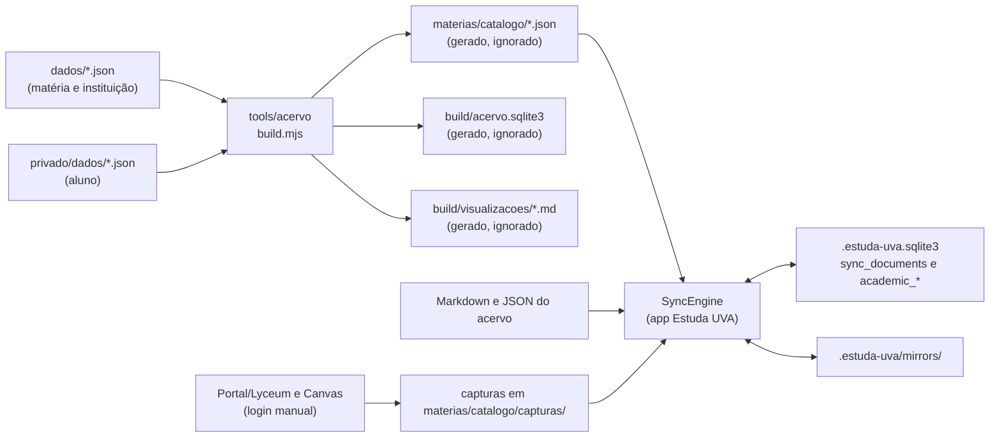

# Dados: visão geral

**Revisado em:** 2026-11-06 · **Base:** commit `3811300` mais a árvore de trabalho não commitada daquele dia (reorganização `privado/`, extração do `estuda-core`).

Este documento descreve onde os dados do projeto vivem, quem os escreve e o que é compartilhável. Cada afirmação cita o código que a fundamenta. Rótulos usados: **Implementado** (existe e foi lido no código), **Parcial**, **Planejado** (só existe como proposta ou contrato sem uso) e **Não verificado**.

Documentos relacionados: [banco privado](banco-privado.md) · [banco público](banco-publico.md) · [sincronização](sincronizacao.md) · [migrações](migracoes.md) · [proveniência e confiança](proveniencia-e-confianca.md) · [formatos e convenções](../referencia/formatos.md) · [arquitetura do acervo (anterior)](../ARQUITETURA_ACERVO.md).

> Esta documentação não autoriza executar SQL nem alterar nenhum banco. Toda mudança de banco exige aprovação prévia, explícita e individual no chat (regra global do usuário). Veja [migrações](migracoes.md).

## 1. Mapa das representações

| # | Representação | Onde | Quem escreve | Versionada no Git | Estado |
|---|---|---|---|---|---|
| 1 | Registros estruturados (JSON, um por arquivo) | `dados/` (matéria e instituição) e `privado/dados/` (aluno) | pessoa, à mão | sim | Implementado |
| 2 | Acervo textual (Markdown, JSON de captura) | `materias/`, `fontes-uva/`, `periodos/`, `docs/`, `privado/` | pessoa e app | sim, exceto `materias/catalogo/` | Implementado |
| 3 | Formato legado para o app | `materias/catalogo/*.json` e `materias/catalogo/curriculos/*.json` | `tools/acervo` | não (ignorado) | Implementado |
| 4 | Banco gerado `build/acervo.sqlite3` | `build/` | `tools/acervo` | não (ignorado) | Implementado |
| 5 | Banco do aplicativo | `<acervo>/.estuda-uva.sqlite3` (+ `-wal`, `-shm`) | app Estuda UVA | não (ignorado) | Implementado |
| 6 | Espelhos de sincronização | `<acervo>/.estuda-uva/mirrors/` | app Estuda UVA | não (ignorado) | Implementado |
| 7 | Banco legado do aplicativo | `<app_data_dir>/estuda-uva.sqlite3` | app (versões antigas) | fora do repositório | Implementado (somente importação) |
| 8 | Originais (PDF, Word, Pages) | `originais/` | pessoa | não (ignorado) | Implementado |

Fundamentos no código:

- Registros e gerador: `tools/acervo/src/carregar.mjs` (`RAIZES_DADOS = ['dados', 'privado/dados']`) e `tools/acervo/build.mjs`.
- Formato legado: `tools/acervo/src/legado.mjs` (`SAIDA_LEGADO = 'materias/catalogo'`).
- Banco gerado: `tools/acervo/src/sqlite.mjs`.
- Banco do aplicativo e espelhos: `app/crates/estuda-core/src/storage.rs` (`open_workspace`) e `app/crates/estuda-core/src/sync.rs` (`MIRROR_ROOT = ".estuda-uva/mirrors"`).
- Regras de Git: `.gitignore` (linhas de `/.estuda-uva.sqlite3*`, `/.estuda-uva/mirrors/`, `/build/`, `/materias/catalogo/...`, `/originais/`, `*.pdf`, `*.docx`, `*.pages` etc.).

## 2. Fluxo dos dados

Leitura do diagrama:

1. A pessoa edita registros em `dados/` ou `privado/dados/`. O gerador `node tools/acervo/build.mjs` valida e produz três saídas: os JSON do formato legado, o banco `build/acervo.sqlite3` e as visualizações Markdown.
2. O aplicativo lê os JSON do formato legado como documentos comuns do acervo. O `SyncEngine` os guarda em `sync_documents` e reconstrói as tabelas `academic_*` a partir deles (`catalog/academic.rs`, `replace_projection`). **A atualização de `dados/` até o app não é automática:** é preciso rodar o gerador e depois sincronizar.
3. O app grava capturas do Portal e do Canvas como arquivos novos em `materias/catalogo/capturas/`, que depois entram na sincronização.
4. `build/acervo.sqlite3` e `.estuda-uva.sqlite3` são bancos distintos. Não há escrita do gerador no banco do app (`tools/acervo/README.md`, seção "Relação com o app").

## 3. Camadas: privado, compartilhável, gerado

A classificação oficial por caminho é um contrato em Rust, o módulo `publication` do crate `estuda-domain` (`crates/estuda-domain/src/publication.rs`, função `classify`). Ela **nega por padrão** e não inspeciona conteúdo.

| Camada (`Layer`) | Prefixos e arquivos | Pode ser publicada? |
|---|---|---|
| `LocalOnly` | `.estuda-uva*`, `originais/`, `chromium-profile/`, sufixos `.sqlite3`, `.sqlite3-wal`, `.sqlite3-shm`, `.sqlite3-journal`, `.sqlite`, `.db`, `.env*` | Nunca, por nenhuma política |
| `Personal` | `privado/`, `cursos/`, `dados/matriculas/`, `dados/notas/`, `dados/trajetorias/`, `dados/trabalhos/`, `materias/catalogo/capturas/`, `REGISTRO_ACADEMICO.md`, `PLANEJAMENTO.md`, `IDEIAS.md`, `dados/meta.json` | Sim, separado do catálogo, só com `PublicationPolicy::OWNER` (decisão do dono, 6/11/2026); o padrão da biblioteca nega |
| `Generated` | `build/`, `materias/catalogo/` (fora de `capturas/`), `app/dist/`, `app/node_modules/`, `app/src-tauri/target/` | Nunca (reconstruível) |
| `Shareable` | `docs/arquitetura/`, `crates/`, `tools/`, `schemas/`, `biblioteca/`, `fontes-uva/`, `dados/instituicao/`, `dados/programas/`, `dados/ofertas/`, `dados/relacoes/`, `dados/periodos/` | Sim |
| `NeedsReview` | todo o resto (por exemplo `dados/disciplinas/`) | Só depois de revisão humana explícita |

**Estado de integração: Planejado.** Nenhum crate do workspace `app/` depende de `estuda-domain` no `Cargo.toml` de `estuda-core` nem de `src-tauri`. A busca `grep estuda-domain` encontrou a dependência apenas em `app/crates/estuda-sync/Cargo.toml`, um crate novo, ainda não commitado e não inspecionado por este documento. Portanto, `classify` e `check_publishable` existem e têm testes, mas nenhum fluxo de publicação os chama hoje.

Observações sobre o contrato:

- `Shareable` inclui `fontes-uva/`, que guarda texto extraído de materiais oficiais da UVA. O contrato de camada não verifica direitos de distribuição. Veja a lacuna L6 abaixo.
- `dados/disciplinas/` é `NeedsReview` no contrato porque, na época em que foi escrito, misturava catálogo e disciplinas cursadas. As disciplinas cursadas hoje estão em `privado/dados/disciplinas/` (12 registros) e `dados/disciplinas/` tem 76.

## 4. Onde está cada tipo de dado

| Tipo | Local | Camada |
|---|---|---|
| Instituição, programas, ofertas curriculares, relações candidatas, períodos | `dados/instituicao/`, `dados/programas/`, `dados/ofertas/<programa>/`, `dados/relacoes/`, `dados/periodos/` | compartilhável |
| Disciplinas canônicas do catálogo | `dados/disciplinas/` (76 registros em 2026-11-06) | a revisar |
| Cursos do Canvas, disciplinas cursadas, matrículas, notas, trajetórias, trabalhos entregues, `meta.json` | `privado/dados/{canvas,disciplinas,matriculas,notas,trajetorias,trabalhos}/` | pessoal (`Personal`) |
| Registro acadêmico pessoal, planejamento, ideias, notas de estudo | `privado/` | pessoal (`Personal`) |
| Textos extraídos de PDFs oficiais, com página e fonte | `fontes-uva/<período>/<matéria>/` | compartilhável pelo contrato; direitos não verificados |
| Atividades e aulas por matéria | `materias/` e `privado/materias/` | misto |
| Progresso de aula, respostas do tutor, histórico de estudo, resumos gerados por IA | tabelas do `.estuda-uva.sqlite3` | `LocalOnly` (banco SQLite) |
| Capturas do Portal/Lyceum e do Canvas | `materias/catalogo/capturas/` e cópia em `sync_documents` | `Personal`, fora de `privado/` (ver L9) |

Contagem de registros em 2026-11-06 (`find ... -name '*.json'`): 174 em `dados/` e 60 em `privado/dados/`, total 234, igual ao relatório de `node tools/acervo/build.mjs --validar` ("OK: 234 registros válidos em dados/").

## 5. Garantias que existem hoje

| Garantia | Mecanismo | Arquivo |
|---|---|---|
| Registros recusam chaves sensíveis (`cpf`, `rg`, `ra`, `senha`, `password`, `cookie`, `token`, `secret`, `credencial`, `email`, `telefone`, `login`, `usuario`) e valores com caminho absoluto, `Bearer ` ou e-mail | validação do gerador | `tools/acervo/src/validar.mjs` (`CHAVES_PROIBIDAS`, `VALORES_PROIBIDOS`) |
| Ausência de dado é `null` com pendência; string vazia é erro | validação do gerador | `validar.mjs` |
| Fonte citada precisa existir no repositório | validação do gerador | `validar.mjs` (`existsSync`) |
| Binários rastreados pelo Git são erro | `--verificar-texto` | `tools/acervo/src/texto.mjs` |
| Bancos, espelhos, capturas, builds e originais ficam fora do Git | `.gitignore` | `.gitignore` |
| Sincronização ignora `originais/` e qualquer segmento de caminho com `senha`, `password`, `credential`, `credencial`, `cookie`, `token`, `secret` | `is_sensitive_or_excluded` | `app/crates/estuda-core/src/sync.rs` |
| Caminhos com `..`, absolutos ou que atravessam link simbólico são recusados | `validate_relative_path`, `safe_existing_path` | `sync.rs` |
| Conflitos entre SQLite, Markdown e JSON são preservados, nunca resolvidos silenciosamente | `reconcile` de três superfícies | `sync.rs` ([detalhes](sincronizacao.md)) |

## 6. Lacunas e contradições encontradas

Estas observações descrevem o estado em 2026-11-06. Nenhuma foi corrigida por este trabalho documental.

- **L1. Os 174 registros de `dados/` citam `privado/` como fonte.** Todos os arquivos de `dados/` contêm `"source": { "file": "privado/..." }` ou `sourceFiles` com `privado/` (contagem: 76 disciplinas, 79 ofertas, 14 relações, 2 programas, 2 períodos, 1 instituição). A regra do `dados/LEIA-ME.md` permite "dados/ citar privado/", mas o cabeçalho de `tools/acervo/src/separar-privado.mjs` diz que registros compartilhados não podem apontar para `privado/`. Quem receber só a parte compartilhável não consegue verificar a proveniência.
- **L2. Escopo do app desatualizado em relação à reorganização.** `catalog/scanner.rs` (linhas 470 e 499 a 507) indexa `docs`, `materias`, `originais`, `fontes-uva`, `periodos` e `cursos`; não inclui `privado/` nem `dados/`. O sincronizador observa só `materias` e `docs` (`sync_watcher.rs`, `WatchSet::from_root`). `cursos/` já não existe na raiz (foi movido para `privado/cursos/`). Consequência: o app não indexa nem sincroniza o conteúdo de `privado/` nem `dados/`. Se isso é intencional não está registrado.
- **L3. `dados/LEIA-ME.md` lista `canvas/`, `matriculas/`, `notas/`, `trajetorias/`, `trabalhos/` e `meta.json` como pastas de `dados/`.** Estão em `privado/dados/` no estado atual; `dados/` tem apenas `disciplinas/`, `instituicao/`, `ofertas/`, `periodos/`, `programas/`, `relacoes/`.
- **L4. `build/acervo.sqlite3` contém dado pessoal e está classificado como `Generated`.** O gerador carrega `dados/` e `privado/dados/` (`carregar.mjs`) e `sqlite.mjs` grava as tabelas `matriculas` (com `docente`), `notas`, `avaliacoes_lyceum` e a lista de arquivos de `privado/`. O arquivo é ignorado pelo Git e continua fora de qualquer publicação por ser banco SQLite, não por causa do dado pessoal (que a decisão de 6/11/2026 permite publicar, separado em `privado/`).
- **L5. Formatos de identificador e de data heterogêneos.** Veja [formatos](../referencia/formatos.md), seções de identificadores e datas.
- **L6. Direitos autorais de `fontes-uva/` não verificados.** O contrato trata o diretório como compartilhável; o texto extraído vem de materiais da UVA e de e-books de terceiros. A própria [arquitetura do acervo](../ARQUITETURA_ACERVO.md) lista isso como decisão pendente.
- **L7. `estuda-domain` não está integrado ao fluxo de dados.** Veja a seção 3.
- **L8. O `.gitignore` não ignora `privado/`.** É o desenho declarado em `AGENTS.md` ("ficam em `privado/`, no mesmo repositório") e permitido pela decisão de 6/11/2026. Como a separação é só de pasta, a verificação dos itens proibidos deve ser feita antes de qualquer publicação. Veja a documentação de segurança e publicação.
- **L9. Capturas pessoais fora de `privado/`.** A decisão de 6/11/2026 pede que dados pessoais fiquem separados em `privado/`, mas as capturas do Portal e do Canvas são gravadas em `materias/catalogo/capturas/` (classe `Personal` no contrato). Não há decisão registrada sobre mover essa pasta.
