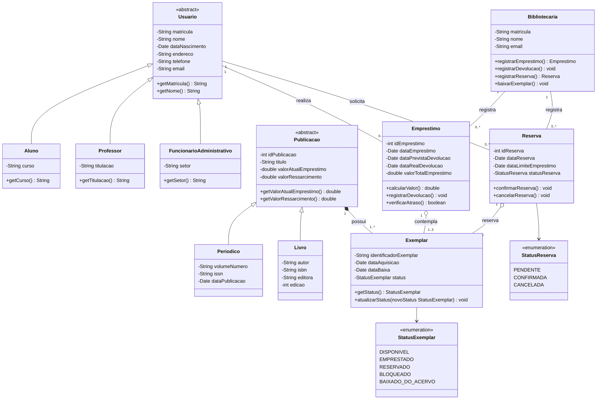

# Diagrama de classes — sistema de biblioteca

> Versão em texto (Mermaid) do `diag_classes.png`, transcrita a partir da imagem. Usada pelo AVA 2 em `../ava2-modelagem-uml-biblioteca.md`. A imagem original fica como referência visual local.

## Leitura textual das relações

- **Herança:** `Aluno`, `Professor` e `FuncionarioAdministrativo` são subclasses de `Usuario` (abstrata). `Periodico` e `Livro` são subclasses de `Publicacao` (abstrata).
- **Empréstimo:** um `Usuario` realiza 0..* empréstimos; uma `Bibliotecaria` registra 0..* empréstimos; cada empréstimo contempla de 1 a 3 `Exemplar`.
- **Reserva:** um `Usuario` solicita 0..* reservas; uma `Bibliotecaria` registra 0..*; cada reserva reserva de 1 a 3 `Exemplar`.
- **Composição:** cada `Publicacao` possui 1..* `Exemplar`.
- **Enumerações:** `Reserva` usa `StatusReserva`; `Exemplar` usa `StatusExemplar`.
