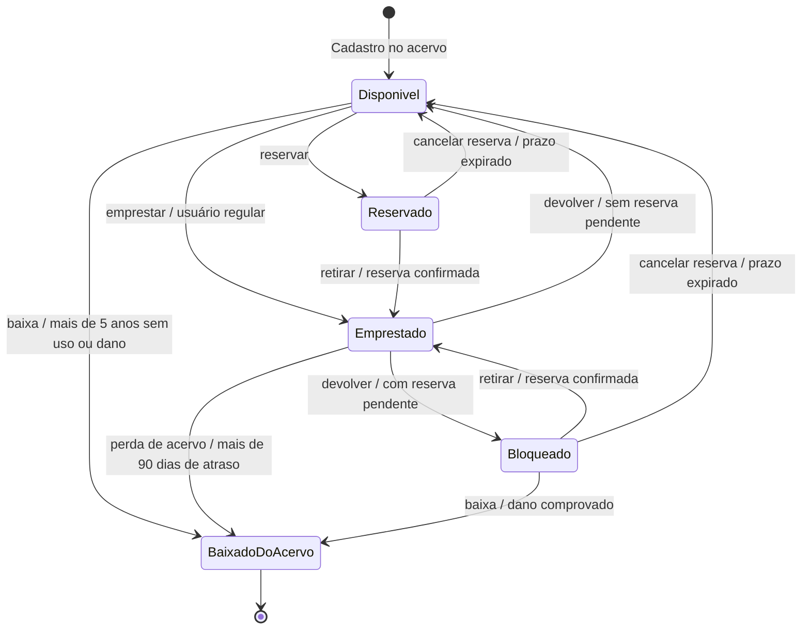

# Diagrama de estados — classe Exemplar

> Versão em texto (Mermaid) do `diag_estados.png`, transcrita a partir da imagem. Usada pelo AVA 2 em `../ava2-modelagem-uml-biblioteca.md`.

## Leitura textual

Um exemplar entra no acervo como `Disponivel`. Pode ser emprestado, reservado ou baixado. `BaixadoDoAcervo` é o estado final.
