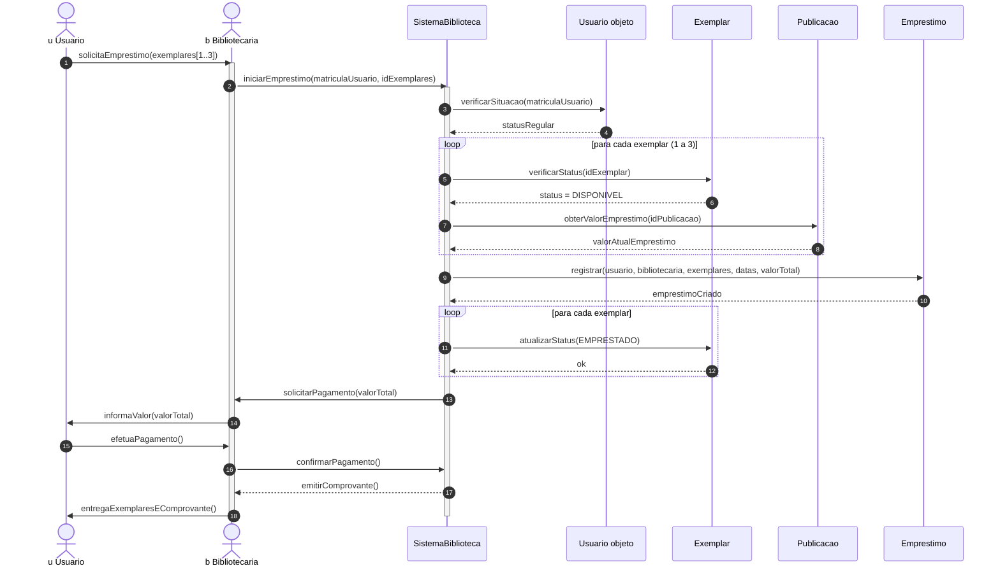

# Diagrama de sequência — empréstimo de exemplar

> Versão em texto (Mermaid) do `diag_sequencia.png`, transcrita a partir da imagem. Usada pelo AVA 2 em `../ava2-modelagem-uml-biblioteca.md`.

## Leitura textual

O usuário pede até três exemplares. O sistema verifica a situação do usuário e a disponibilidade de cada exemplar, registra o empréstimo, marca os exemplares como emprestados, solicita o pagamento e entrega os exemplares com o comprovante.
